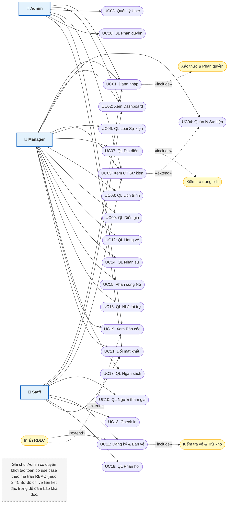

# Tài liệu Use Case & Sơ đồ Ca sử dụng - Hệ thống Quản lý Sự kiện

## 1. Tổng quan hệ thống & Phân tích Tác nhân (Actors)

Hệ thống Phần mềm Quản lý Sự kiện hỗ trợ toàn diện các khâu lập kế hoạch, chuẩn bị, vận hành và tổng kết sự kiện. Hệ thống xác định 3 tác nhân chính (Actors) với vai trò và phạm vi trách nhiệm như sau:

| Tác nhân | Mô tả vai trò | Quyền hạn chính | Giới hạn quyền hạn |
| :--- | :--- | :--- | :--- |
| **Admin** | Quản trị viên cấp cao nhất của hệ thống. | Toàn quyền kiểm soát hệ thống: quản lý tài khoản người dùng, phân quyền, cấu hình thông số hệ thống, giám sát toàn bộ danh mục, sự kiện, tài chính và báo cáo. | Phải đảm bảo luôn duy trì ít nhất một tài khoản Admin hoạt động trong CSDL. |
| **Manager** | Người phụ trách trực tiếp tổ chức và điều phối sự kiện. | Quản lý vòng đời sự kiện (tạo, sửa, hủy), lập lịch chương trình, quản lý diễn giả, địa điểm, vé, người tham gia, phân công nhân sự, quản lý chi phí, nhà tài trợ và xem báo cáo. | Không được xóa/khóa tài khoản Admin hoặc Manager khác; chỉ được tạo và cập nhật tài khoản vai trò Staff; không can thiệp cấu hình cấp hệ thống trừ khi được Admin mở quyền tùy chọn tại F20. |
| **Staff** | Nhân viên tác nghiệp và vận hành tại sự kiện. | Thực hiện các nghiệp vụ tiếp nhận người tham dự: tra cứu thông tin, đăng ký tham gia, soát vé/check-in, xem lịch trình, xem thông tin nhân sự và ghi nhận phản hồi. | Không thể phân công nhân sự, không quản lý ngân sách/chi phí, không xóa dữ liệu gốc và không đổi cấu hình hệ thống. |

---

## 2. Bảng tổng hợp Use Case & Ánh xạ Form (UC01 – UC21)

| Mã UC | Tên Use Case | Form | Tác nhân chính | Phân loại nghiệp vụ |
| :--- | :--- | :--- | :--- | :--- |
| **UC01** | Đăng nhập hệ thống | F01 | Admin, Manager, Staff | Xác thực & Phân quyền |
| **UC02** | Xem Dashboard | F02 | Admin, Manager, Staff | Thống kê & Tổng quan |
| **UC03** | Quản lý người dùng | F03 | Admin, Manager | Quản trị tài khoản |
| **UC04** | Quản lý sự kiện | F04 | Admin, Manager | Quản lý sự kiện |
| **UC05** | Xem chi tiết sự kiện | F05 | Admin, Manager, Staff | Điều phối trung tâm |
| **UC06** | Quản lý loại sự kiện | F06 | Admin, Manager | Quản lý danh mục |
| **UC07** | Quản lý địa điểm | F07 | Admin, Manager | Quản lý cơ sở vật chất |
| **UC08** | Quản lý lịch chương trình | F08 | Admin, Manager | Timeline sự kiện |
| **UC09** | Quản lý diễn giả / khách mời | F09 | Admin, Manager | Quản lý nhân vật chủ chốt |
| **UC10** | Quản lý người tham gia | F10 | Admin, Manager, Staff | Hồ sơ khách tham dự |
| **UC11** | Đăng ký tham gia sự kiện | F11 | Admin, Manager, Staff | Tiếp nhận ghi danh & Bán vé |
| **UC12** | Quản lý vé | F12 | Admin, Manager | Quản lý hạng vé & Phát hành |
| **UC13** | Check-in sự kiện | F13 | Admin, Manager, Staff | Điểm danh & Soát vé |
| **UC14** | Quản lý nhân sự | F14 | Admin, Manager | Danh mục ban tổ chức/CTV |
| **UC15** | Phân công nhân sự | F15 | Admin, Manager | Điều phối ca trực |
| **UC16** | Quản lý nhà tài trợ | F16 | Admin, Manager | Quản lý gói tài trợ |
| **UC17** | Quản lý ngân sách / chi phí | F17 | Admin, Manager | Tài chính & Dự toán |
| **UC18** | Quản lý phản hồi | F18 | Admin, Manager, Staff | Khảo sát & Đánh giá |
| **UC19** | Báo cáo & Thống kê | F19 | Admin, Manager, Staff | Báo cáo & In ấn |
| **UC20** | Quản lý nhóm quyền & Phân quyền | F20 | Admin | Quản trị hệ thống |
| **UC21** | Đổi mật khẩu cá nhân | Dialog | Admin, Manager, Staff | Bảo mật tài khoản |

---

## 3. Đặc tả chi tiết từng Use Case

### UC01 – Đăng nhập (F01)
- **Actor:** Admin, Manager, Staff.
- **Luồng chính:** Người dùng mở phần mềm → Nhập Tên đăng nhập và Mật khẩu → Nhấn "Đăng nhập" → Hệ thống kiểm tra tài khoản, kiểm tra trạng thái khóa (vĩnh viễn / tạm thời brute-force), thẩm định mật khẩu BCrypt → Nếu đúng, reset số lần nhập sai về 0, xóa mốc khóa tạm thời → Xác định vai trò (RBAC) → Điều hướng vào Dashboard (F02).
- **Luồng phụ / Ngoại lệ (Kiểm soát Brute-force & Khóa tài khoản):**
  - **Tài khoản đang bị khóa tạm thời:** Nếu `KhoaDenKhi > Now`, hệ thống từ chối đăng nhập, hiển thị thông báo thời gian còn lại kèm 3 hướng giải quyết: (1) Chờ hết thời gian khóa, (2) Đổi mật khẩu qua chức năng Quên mật khẩu, (3) Liên hệ Admin để mở khóa.
  - **Nhập sai mật khẩu:** Tăng biến đếm số lần sai.
    - Sai từ 1 đến 4 lần: Cảnh báo thông tin sai kèm số lần thử còn lại.
    - Sai lần thứ 5 liên tiếp: Khóa tạm thời 1 phút.
    - Sai các lần tiếp theo (lần 6, 7, 8+): Khóa tăng lũy tiến (5 phút, 15 phút, 30 phút).
  - **Cơ chế mở khóa tự động:** Khi hết hạn khóa tạm thời (`Now >= KhoaDenKhi`), hệ thống tự động mở lại cho phép người dùng tiếp tục thao tác.
- **Quan hệ:** `<<include>>` Kiểm tra tài khoản, Kiểm tra mật khẩu, Kiểm tra thời gian khóa Brute-force, Xác định quyền. `<<extend>>` sang UC21 (Quên / Đổi mật khẩu để tự mở khóa).

### UC02 – Xem Dashboard (F02)
- **Actor:** Admin, Manager, Staff.
- **Nghiệp vụ:** Truy vấn CSDL và hiển thị tức thì các chỉ số KPI: Tổng số sự kiện (chuẩn bị, sắp diễn ra, hoàn thành), tổng người tham gia, số vé đã bán, tổng doanh thu, tổng chi phí thực tế và biểu đồ diễn biến theo thời gian.
- **Ràng buộc:** Không cho phép xóa hoặc khóa tài khoản Admin cuối cùng đang hoạt động.

### UC03 – Quản lý người dùng (F03)
- **Actor:** Admin.
- **Nghiệp vụ:** 
  - Thêm tài khoản mới, cập nhật thông tin nhân viên, khóa/mở khóa tài khoản vĩnh viễn, phân quyền vai trò.
  - **Mở khóa tài khoản do Brute-force:** Admin tra cứu danh sách tài khoản bị khóa tạm thời hoặc nhập sai nhiều lần, nhấn nút "Mở khóa tài khoản" để reset số lần sai về 0 và đưa tài khoản về trạng thái Hoạt động ngay lập tức.
- **Ràng buộc:** Không cho phép xóa hoặc khóa tài khoản Admin cuối cùng đang hoạt động.

### UC04 – Quản lý sự kiện (F04)
- **Actor:** Admin, Manager.
- **Nghiệp vụ:** Khởi tạo sự kiện mới, sửa thông tin, tìm kiếm, lọc theo trạng thái.
- **Ràng buộc:** Kiểm tra tính hợp lệ của thời gian, địa điểm, sức chứa. Chỉ cho phép xóa khi sự kiện chưa phát sinh dữ liệu liên quan (người tham gia, vé, chi phí); nếu đã có dữ liệu, bắt buộc chuyển sang trạng thái "Đã hủy".
- **Quan hệ:** `<<extend>>` sang UC05 (Xem chi tiết sự kiện).

### UC05 – Xem chi tiết sự kiện (F05)
- **Actor:** Admin, Manager, Staff (chế độ xem).
- **Nghiệp vụ:** Trung tâm điều phối hiển thị 9 tab chức năng liên kết: Thông tin sự kiện, Lịch chương trình, Diễn giả, Người tham gia, Vé phát hành, Phân công nhân sự, Nhà tài trợ, Chi phí phát sinh và Đánh giá phản hồi.

### UC06 – Quản lý loại sự kiện (F06)
- **Actor:** Admin, Manager.
- **Nghiệp vụ:** Thêm, sửa, xóa, tìm kiếm danh mục phân loại sự kiện (Hội thảo, Workshop...). Chặn xóa nếu loại sự kiện đã được gán cho bất kỳ sự kiện nào trong hệ thống.

### UC07 – Quản lý địa điểm (F07)
- **Actor:** Admin, Manager.
- **Nghiệp vụ:** Quản lý danh mục hội trường, phòng họp, sức chứa tối đa.
- **Quan hệ & Ràng buộc:** `<<include>>` Kiểm tra trùng lịch. Ngăn chặn đặt trùng cùng một địa điểm trong các khung giờ giao thoa nhau.

### UC08 – Quản lý lịch chương trình (F08)
- **Actor:** Admin, Manager.
- **Nghiệp vụ:** Lập timeline chi tiết từng tiết mục/nội dung trong sự kiện, gán diễn giả và phòng chức năng.
- **Ràng buộc:** Thời gian kết thúc phải lớn hơn thời gian bắt đầu; thời gian chương trình con phải nằm trọn trong thời gian sự kiện; không trùng phòng và không trùng lịch cùng một diễn giả.

### UC09 – Quản lý diễn giả / khách mời (F09)
- **Actor:** Admin, Manager.
- **Nghiệp vụ:** Quản lý hồ sơ cá nhân, chức vụ, học hàm, đơn vị công tác, hình ảnh và liên kết diễn giả vào lịch trình sự kiện.

### UC10 – Quản lý người tham gia (F10)
- **Actor:** Admin, Manager, Staff.
- **Nghiệp vụ:** Thêm mới, chỉnh sửa hồ sơ khách tham dự; xem lịch sử đăng ký, hạng vé đã mua, trạng thái thanh toán và lịch sử check-in xuyên suốt qua các sự kiện.

### UC11 – Đăng ký tham gia sự kiện (F11)
- **Actor:** Admin, Manager, Staff.
- **Luồng thực hiện:** Chọn sự kiện → Chọn người tham gia → Chọn loại vé & Nhập số lượng → Hệ thống thẩm định tính hợp lệ của sự kiện và số vé còn lại → Tính tổng tiền (Đơn giá × Số lượng) → Xác nhận lưu → Tự động trừ số lượng vé khả dụng và cấp mã vé/QR.
- **Quan hệ:** `<<include>>` Kiểm tra sự kiện, Kiểm tra vé tồn, Tính tổng tiền, Cập nhật tồn kho vé, Bọc Database Transaction. `<<extend>>` từ UC12.

### UC12 – Quản lý vé (F12)
- **Actor:** Admin, Manager.
- **Nghiệp vụ:** Thiết lập các hạng vé (Standard, VIP...), giá bán, số lượng phát hành, thời gian mở/đóng bán.
- **Công thức & Ràng buộc:** Số lượng còn lại = Số lượng phát hành − Số lượng đã bán. Không cho phép giảm số vé phát hành thấp hơn số vé thực tế đã bán ra.

### UC13 – Check-in sự kiện (F13)
- **Actor:** Admin, Manager, Staff.
- **Luồng thực hiện:** Nhập mã vé hoặc quét mã QR → Kiểm tra vé hợp lệ, đúng sự kiện, đã thanh toán → Kiểm tra trạng thái điểm danh (chặn nếu đã check-in trước đó) → Ghi nhận mốc thời gian check-in thành công và cập nhật tỷ lệ có mặt theo thời gian thực.
- **Quan hệ:** `<<include>>` Kiểm tra mã vé, Kiểm tra trạng thái vé, Ghi nhận thời gian check-in.

### UC14 – Quản lý nhân sự (F14)
- **Actor:** Admin, Manager.
- **Nghiệp vụ:** Quản lý danh bạ ban tổ chức, điều phối viên, tình nguyện viên, chức vụ, phòng ban và trạng thái sẵn sàng.

### UC15 – Phân công nhân sự (F15)
- **Actor:** Admin, Manager.
- **Luồng thực hiện:** Chọn sự kiện → Chọn nhân sự → Chọn vai trò đảm nhiệm (Lễ tân, Kỹ thuật...) → Chọn ca làm việc.
- **Ràng buộc:** `<<include>>` Kiểm tra trùng ca. Chặn phân công 1 nhân sự vào 2 ca làm việc có thời gian giao thoa; không phân công nhân sự đã nghỉ việc hoặc cho sự kiện đã kết thúc.

### UC16 – Quản lý nhà tài trợ (F16)
- **Actor:** Admin, Manager.
- **Nghiệp vụ:** Quản trị hồ sơ doanh nghiệp tài trợ, gán vào sự kiện, quản lý các gói tài trợ (Diamond, Gold, Silver...) và theo dõi giá trị tài trợ (tiền mặt/hiện vật).

### UC17 – Quản lý ngân sách / chi phí (F17)
- **Actor:** Admin, Manager.
- **Nghiệp vụ:** Nhập các khoản thực chi theo danh mục, tính tổng chi, đối chiếu ngân sách dự kiến và kích hoạt cảnh báo khi chi phí chạm ngưỡng định mức (ví dụ vượt 80% ngân sách).
- **Quan hệ:** `<<include>>` Tính tổng chi, Tính ngân sách còn lại, Kiểm tra vượt định mức.

### UC18 – Quản lý phản hồi (F18)
- **Actor:** Admin, Manager, Staff.
- **Nghiệp vụ:** Thu thập đánh giá (1★ đến 5★) kèm nhận xét chi tiết sau sự kiện. Tự động tính điểm trung bình hài lòng (CSAT).
- **Ràng buộc:** Chỉ người tham gia đã check-in mới được gửi phản hồi; giới hạn 1 đánh giá/người/sự kiện.

### UC19 – Xem Báo cáo & Thống kê (F19)
- **Actor:** Admin, Manager (Staff: Chế độ chỉ xem).
- **Nghiệp vụ:** Chọn loại báo cáo (Tài chính, Vé, Phản hồi) → Chọn bộ lọc (Thời gian, Sự kiện) → Hệ thống truy vấn CSDL, vẽ biểu đồ (LiveCharts) và hiển thị dữ liệu lên ReportViewer (RDLC) → Hỗ trợ xuất Excel/PDF hoặc in ấn.
- **Quan hệ:** `<<include>>` Lọc dữ liệu; `<<extend>>` Xuất báo cáo RDLC/Excel.

### UC20 – Quản lý Nhóm quyền & Phân quyền (F20)
- **Actor:** Admin.
- **Nghiệp vụ / Luồng thực hiện:** Admin chọn Nhóm quyền cần cấu hình (hoặc tạo nhóm mới) → Hệ thống tải danh sách các Form/Chức năng → Admin tích chọn cấp quyền hoặc bỏ chọn thu hồi quyền → Nhấn "Lưu cấu hình" → CSDL cập nhật bảng PhanQuyen.
- **Ràng buộc:** Nhóm quyền Admin mặc định luôn có đầy đủ quyền và không thể bị thu hồi quyền hệ thống.
- **Quan hệ:** Không có.

### UC21 – Đổi mật khẩu / Quên mật khẩu & Mở khóa tài khoản (Dialog / Form)
- **Actor:** Admin, Manager, Staff.
- **Nghiệp vụ / Luồng thực hiện:** 
  - **Trường hợp Đổi mật khẩu chủ động:** Người dùng đăng nhập thành công mở form Đổi mật khẩu → Nhập Mật khẩu hiện tại, Mật khẩu mới và Xác nhận mật khẩu mới → Hệ thống kiểm tra mật khẩu hiện tại khớp CSDL → Kiểm tra mật khẩu mới hợp lệ (độ dài >= 6, không trùng mật khẩu cũ) → Băm BCrypt và cập nhật mật khẩu mới.
  - **Trường hợp Quên mật khẩu để tự mở khóa tài khoản:** Người dùng bị khóa tạm thời do nhập sai quá 5 lần tại màn hình F01 → Chọn "Quên mật khẩu" → Nhập Email đã đăng ký → Hệ thống gửi mã xác thực OTP qua Email → Nhập đúng OTP → Cho phép thiết lập mật khẩu mới → BLL tự động cập nhật hash mật khẩu mới, đồng thời reset `SoLanDangNhapSai = 0`, xóa mốc `KhoaDenKhi` và khôi phục trạng thái hoạt động ngay lập tức.
- **Ràng buộc:** Mật khẩu mới phải từ 6 ký tự trở lên; xác nhận mật khẩu phải trùng khớp 100%; mật khẩu mới không được trùng mật khẩu cũ.
- **Quan hệ:** `<<include>>` Kiểm tra mật khẩu cũ / Xác thực OTP, Băm mật khẩu BCrypt, Reset khóa Brute-force.

---

## 4. Bảng tổng hợp quan hệ Include & Extend giữa các Use Case

| Loại qhệ | Use Case gốc | Use Case được liên kết | Ý nghĩa / Điều kiện thực hiện |
| :--- | :--- | :--- | :--- |
| `<<include>>` | UC01 (Đăng nhập) | Kiểm tra tài khoản, Kiểm tra mật khẩu, Xác định quyền | Bắt buộc phải xác thực thông tin và phân quyền trước khi cấp quyền truy cập. |
| `<<include>>` | UC01 (Đăng nhập) | Kiểm tra Brute-force & Khóa tạm thời | Tự động kiểm tra thời gian khóa `KhoaDenKhi` và đếm số lần sai trước khi xác thực mật khẩu. |
| `<<include>>` | UC04 (Quản lý sự kiện) | Kiểm tra dữ liệu, Kiểm tra địa điểm | Bắt buộc kiểm tra tính hợp lệ và xung đột địa điểm trước khi lưu sự kiện. |
| `<<include>>` | UC07 (Quản lý địa điểm) | Kiểm tra trùng lịch | Bắt buộc đối soát giao thoa thời gian giữa các sự kiện cùng sử dụng 1 địa điểm. |
| `<<include>>` | UC08 (Lập lịch chương trình) | Kiểm tra logic thời gian, Kiểm tra diễn giả | Bắt buộc kiểm tra Start < End, nằm trong sự kiện và diễn giả không bị trùng lịch. |
| `<<include>>` | UC11 (Đăng ký tham gia) | Kiểm tra vé tồn, Tính tổng tiền, Cập nhật số vé | Bắt buộc kiểm tra tồn kho và tự động giảm số vé khả dụng ngay khi đăng ký thành công. |
| `<<include>>` | UC11 (Đăng ký tham gia) | Bọc Database Transaction | Bắt buộc dùng Transaction để rollback nếu lưu chi tiết vé thất bại. |
| `<<include>>` | UC13 (Check-in) | Kiểm tra mã vé, Ghi nhận thời gian check-in | Bắt buộc kiểm tra tính hợp lệ và lưu mốc thời gian điểm danh thực tế. |
| `<<include>>` | UC15 (Phân công nhân sự) | Kiểm tra trùng ca | Bắt buộc chặn việc phân công một người trực 2 nơi cùng một thời điểm. |
| `<<include>>` | UC17 (Quản lý chi phí) | Tính ngân sách còn lại, Kiểm tra vượt ngưỡng | Bắt buộc tính lại số dư ngân sách và kích hoạt cảnh báo nếu vượt hạn mức. |
| `<<extend>>` | UC01 (Đăng nhập) | UC21 (Quên mật khẩu & Tự mở khóa) | Mở rộng luồng xác thực email OTP để đặt lại mật khẩu và tự mở khóa tài khoản khi bị lockout. |
| `<<extend>>` | UC04 (Quản lý sự kiện) | UC05 (Xem chi tiết sự kiện) | Khi người dùng chọn xem sâu vào một sự kiện cụ thể từ danh sách. |
| `<<extend>>` | UC11 (Đăng ký tham gia) | UC12 (Quản lý vé) | Nghiệp vụ đăng ký mở rộng thông tin chi tiết từ các gói vé đã phát hành. |
| `<<extend>>` | UC11 (Đăng ký tham gia) | In Phiếu đăng ký / Vé điện tử RDLC | Sau khi lưu vé thành công, mở màn hình xem trước và in vé RDLC. |
| `<<extend>>` | UC13 (Check-in) | Quét mã QR qua Camera | Mở rộng phương thức nhập liệu: hỗ trợ quét trực tiếp bên cạnh việc gõ mã bằng tay. |
| `<<extend>>` | UC17 (Quản lý chi phí) | In Báo cáo Doanh thu & Quyết toán RDLC | Lọc dữ liệu theo ngày và xuất bản in báo cáo tài chính RDLC chuẩn. |

---

## 5. Sơ đồ Use Case tổng thể dạng Mermaid

---

## 6. Luồng nghiệp vụ liên hoàn toàn hệ thống

Quá trình vận hành một sự kiện được triển khai xuyên suốt qua 4 giai đoạn:

1. **Giai đoạn 1 – Thiết lập & Chuẩn bị:** 
   - Admin/Manager cấu hình danh mục gốc (Loại sự kiện, Địa điểm, Diễn giả, Nhân sự).
   - Khởi tạo sự kiện chính (F04/UC04) → Thiết lập timeline lịch trình con (F08) → Phát hành các hạng vé mở bán (F12) → Phân công ca trực cho nhân sự (F15) → Gán đối tác tài trợ (F16) → Lập dự toán ngân sách chi phí (F17).

2. **Giai đoạn 2 – Tiếp nhận đăng ký & Bán vé:** 
   - Khách hàng/Nhân viên nhập thông tin người tham gia (F10) → Chọn sự kiện và hạng vé mong muốn (F11).
   - Hệ thống tự động kiểm tra tồn kho vé khả dụng → Ghi nhận thanh toán và phát hành mã vé/mã QR check-in qua Database Transaction.
   - CSDL tự động trừ tồn kho vé phát hành (F12) → Xuất và xem trước bản in vé / phiếu thu RDLC.

3. **Giai đoạn 3 – Điều phối On-site ngày diễn ra sự kiện:** 
   - Người tham dự xuất trình mã vé/QR tại lối vào → Nhân viên sử dụng camera quét hoặc nhập mã trên Form Check-in (F13).
   - Hệ thống kiểm tra điều kiện hợp lệ và ngăn chặn vé quét lại → Xác nhận check-in thành công và cập nhật tỷ lệ có mặt theo thời gian thực lên Dashboard (F02).

4. **Giai đoạn 4 – Khảo sát & Quyết toán sau sự kiện:** 
   - Sự kiện hoàn thành → Hệ thống mở tiếp nhận đánh giá/phản hồi từ các khách đã check-in (F18).
   - Kế toán/Manager tập hợp hóa đơn thực tế và chốt quyết toán chi phí (F17) → Kết xuất báo cáo doanh thu, chi phí, lợi nhuận ròng có lọc theo ngày ra định dạng RDLC chuẩn.
