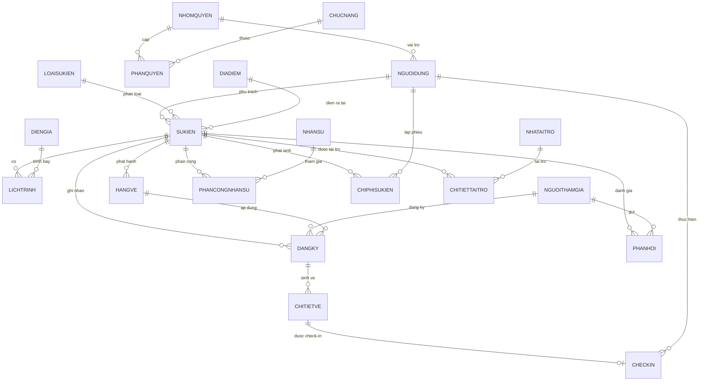

# Thiết kế Cơ sở Dữ liệu - Hệ thống Quản lý Sự kiện

- **Hệ Quản trị CSDL:** Microsoft SQL Server 2019 / 2022 (hoặc SQL Server LocalDB).
- **Mã hóa chuỗi:** Unicode UTF-8 / UTF-16 (`NVARCHAR`).
- **Toàn vẹn dữ liệu:** Ràng buộc khóa ngoại (Foreign Keys - FK), Khóa chính (Primary Keys - PK), Ràng buộc duy nhất (UNIQUE) và Ràng buộc giá trị (CHECK).

---

## 1. Danh sách 20 Bảng CSDL Chi tiết

### 1.1. Nhóm Quản trị Hệ thống & Phân quyền

#### 1. Bảng `NhomQuyen` (Vai trò người dùng)
| Tên cột | Kiểu dữ liệu (SQL Server) | Ràng buộc | Mô tả |
| :--- | :--- | :--- | :--- |
| `MaNhomQuyen` | `VARCHAR(20)` | **PK** | Mã nhóm quyền (`ADMIN`, `MANAGER`, `STAFF`) |
| `TenNhomQuyen` | `NVARCHAR(50)` | NOT NULL | Tên hiển thị nhóm quyền |
| `MoTa` | `NVARCHAR(255)` | NULL | Mô tả vai trò và phạm vi thẩm quyền |

#### 2. Bảng `NguoiDung` (Tài khoản người dùng)
| Tên cột | Kiểu dữ liệu (SQL Server) | Ràng buộc | Mô tả |
| :--- | :--- | :--- | :--- |
| `MaNguoiDung` | `VARCHAR(20)` | **PK** | Mã người dùng tự sinh (`USR_...`) |
| `TenDangNhap` | `VARCHAR(50)` | **UNIQUE**, NOT NULL | Tên đăng nhập hệ thống |
| `MatKhauHash` | `VARCHAR(255)` | NOT NULL | Mật khẩu băm (BCrypt / PBKDF2) |
| `HoTen` | `NVARCHAR(100)` | NOT NULL | Họ và tên người dùng |
| `Email` | `VARCHAR(100)` | NOT NULL | Email liên hệ (dùng gửi OTP mở khóa/đặt lại mật khẩu) |
| `SoDienThoai` | `VARCHAR(15)` | NULL | Số điện thoại liên hệ |
| `MaNhomQuyen` | `VARCHAR(20)` | **FK** $\to$ `NhomQuyen` | Nhóm quyền gán cho tài khoản |
| `TrangThai` | `NVARCHAR(30)` | NOT NULL, DEFAULT N'Hoạt động' | Trạng thái (`Hoạt động`, `Khóa tạm thời`, `Khóa vĩnh viễn`) |
| `LanDoiMatKhauGanNhat` | `DATETIME` | NULL | Mốc thời gian đổi mật khẩu gần nhất |
| `SoLanDangNhapSai` | `INT` | NOT NULL, DEFAULT 0 | Số lần nhập sai mật khẩu liên tiếp (chống Brute-force, reset = 0 khi đăng nhập đúng) |
| `KhoaDenKhi` | `DATETIME` | NULL | Mốc thời gian khóa tạm thời (NULL nếu không khóa; > GETDATE() là đang bị khóa) |

> **Cơ chế chống Brute-force & Mở khóa tài khoản (BR-19):**
> - Khi xác thực sai mật khẩu: Tăng `SoLanDangNhapSai = SoLanDangNhapSai + 1`. Nếu `SoLanDangNhapSai >= 5`, tính toán mốc `KhoaDenKhi = DATEADD(minute, @ThoiGianKhoa, GETDATE())` và cập nhật `TrangThai = N'Khóa tạm thời'`.
> - Thời gian khóa tăng dần theo số lần sai: Lần thứ 5 khóa 1 phút; lần 6 khóa 5 phút; lần 7 khóa 15 phút; lần 8+ khóa 30 phút.
> - Hỗ trợ 3 cách mở khóa:
>   1. **Tự động theo thời gian:** Khi `GETDATE() >= KhoaDenKhi`, hệ thống tự cho phép đăng nhập lại.
>   2. **Đổi mật khẩu thành công:** Cập nhật mật khẩu mới, đồng thời reset `SoLanDangNhapSai = 0`, `KhoaDenKhi = NULL`, `TrangThai = N'Hoạt động'`.
>   3. **Admin can thiệp tại F03:** Admin mở khóa thủ công, reset `SoLanDangNhapSai = 0`, `KhoaDenKhi = NULL`, `TrangThai = N'Hoạt động'`.

#### 3. Bảng `ChucNang` (Danh mục màn hình / chức năng)
| Tên cột | Kiểu dữ liệu (SQL Server) | Ràng buộc | Mô tả |
| :--- | :--- | :--- | :--- |
| `MaChucNang` | `VARCHAR(20)` | **PK** | Mã chức năng (`UC01`, `UC02`,...) |
| `TenChucNang` | `NVARCHAR(100)` | NOT NULL | Tên mô tả chức năng |
| `MaForm` | `VARCHAR(20)` | NOT NULL | Mã màn hình tương ứng (`F01`, `F02`,...) |

#### 4. Bảng `PhanQuyen` (Ma trận phân quyền)
| Tên cột | Kiểu dữ liệu (SQL Server) | Ràng buộc | Mô tả |
| :--- | :--- | :--- | :--- |
| `MaNhomQuyen` | `VARCHAR(20)` | **PK, FK** $\to$ `NhomQuyen` | Mã nhóm quyền |
| `MaChucNang` | `VARCHAR(20)` | **PK, FK** $\to$ `ChucNang` | Mã chức năng |
| `CoQuyen` | `BIT` | NOT NULL, DEFAULT 1 | Cờ cấp quyền (1: Có quyền, 0: Chặn) |

---

### 1.2. Nhóm Danh mục Dùng chung

#### 5. Bảng `LoaiSuKien` (Hình thức tổ chức sự kiện)
| Tên cột | Kiểu dữ liệu (SQL Server) | Ràng buộc | Mô tả |
| :--- | :--- | :--- | :--- |
| `MaLoaiSK` | `VARCHAR(20)` | **PK** | Mã loại sự kiện (`LSK_...`) |
| `TenLoaiSK` | `NVARCHAR(100)` | NOT NULL | Tên loại sự kiện (Hội thảo, Workshop...) |
| `MoTa` | `NVARCHAR(255)` | NULL | Mô tả chi tiết |
| `TrangThai` | `NVARCHAR(20)` | NOT NULL, DEFAULT N'Hoạt động' | `Hoạt động` hoặc `Ngừng áp dụng` |

#### 6. Bảng `DiaDiem` (Cơ sở hạ tầng & Hội trường)
| Tên cột | Kiểu dữ liệu (SQL Server) | Ràng buộc | Mô tả |
| :--- | :--- | :--- | :--- |
| `MaDiaDiem` | `VARCHAR(20)` | **PK** | Mã địa điểm (`DD_...`) |
| `TenDiaDiem` | `NVARCHAR(150)` | NOT NULL | Tên hội trường / trung tâm hội nghị |
| `DiaChi` | `NVARCHAR(255)` | NOT NULL | Địa chỉ chi tiết |
| `SucChuaToiDa` | `INT` | NOT NULL, CHECK > 0 | Sức chứa số người tối đa |
| `NguoiQuanLy` | `NVARCHAR(100)` | NULL | Đầu mối quản lý địa điểm |
| `SoDienThoai` | `VARCHAR(15)` | NULL | Số điện thoại liên hệ địa điểm |
| `TrangThai` | `NVARCHAR(20)` | NOT NULL, DEFAULT N'Hoạt động' | `Hoạt động`, `Bảo trì`, `Ngừng sử dụng` |

#### 7. Bảng `DienGia` (Diễn giả & Khách mời)
| Tên cột | Kiểu dữ liệu (SQL Server) | Ràng buộc | Mô tả |
| :--- | :--- | :--- | :--- |
| `MaDienGia` | `VARCHAR(20)` | **PK** | Mã diễn giả (`DG_...`) |
| `HoTen` | `NVARCHAR(100)` | NOT NULL | Họ tên diễn giả / chuyên gia |
| `ChucVu` | `NVARCHAR(100)` | NULL | Chức danh, học hàm, học vị |
| `DonVi` | `NVARCHAR(150)` | NULL | Cơ quan / Đơn vị công tác |
| `Email` | `VARCHAR(100)` | NULL | Email liên hệ |
| `SoDienThoai` | `VARCHAR(15)` | NULL | Số điện thoại liên hệ |
| `TieuSu` | `NVARCHAR(MAX)` | NULL | Tiểu sử và thành tích nổi bật |
| `DuongDanAnh` | `NVARCHAR(255)` | NULL | Đường dẫn ảnh chân dung |
| `TrangThai` | `NVARCHAR(20)` | NOT NULL, DEFAULT N'Hoạt động' | `Hoạt động`, `Ngừng hợp tác` |

#### 8. Bảng `NhanSu` (Nhân sự & Tình nguyện viên ban tổ chức)
| Tên cột | Kiểu dữ liệu (SQL Server) | Ràng buộc | Mô tả |
| :--- | :--- | :--- | :--- |
| `MaNhanSu` | `VARCHAR(20)` | **PK** | Mã nhân sự (`NS_...`) |
| `HoTen` | `NVARCHAR(100)` | NOT NULL | Họ và tên nhân viên / tình nguyện viên |
| `SoDienThoai` | `VARCHAR(15)` | NOT NULL | Số điện thoại liên hệ |
| `Email` | `VARCHAR(100)` | NULL | Hòm thư điện tử |
| `ChucDanh` | `NVARCHAR(50)` | NULL | Chức vụ (Trưởng nhóm, CTV, Kỹ thuật viên...) |
| `PhongBan` | `NVARCHAR(50)` | NULL | Phòng ban / Ban chuyên trách |
| `TrangThai` | `NVARCHAR(20)` | NOT NULL, DEFAULT N'Hoạt động' | `Hoạt động`, `Nghỉ việc` |

#### 9. Bảng `NhaTaiTro` (Đối tác tài trợ)
| Tên cột | Kiểu dữ liệu (SQL Server) | Ràng buộc | Mô tả |
| :--- | :--- | :--- | :--- |
| `MaNhaTaiTro` | `VARCHAR(20)` | **PK** | Mã nhà tài trợ (`NTT_...`) |
| `TenToChuc` | `NVARCHAR(150)` | NOT NULL | Tên công ty, tập đoàn hoặc nhà hảo tâm |
| `NguoiDaiDien` | `NVARCHAR(100)` | NULL | Họ tên đại diện liên hệ |
| `Email` | `VARCHAR(100)` | NULL | Email công vụ |
| `SoDienThoai` | `VARCHAR(15)` | NULL | Số điện thoại liên lạc |
| `DiaChi` | `NVARCHAR(255)` | NULL | Địa chỉ trụ sở |
| `GhiChu` | `NVARCHAR(255)` | NULL | Ghi chú thêm |

---

### 1.3. Nhóm Quản lý Sự kiện & Lịch trình

#### 10. Bảng `SuKien` (Thông tin tổng thể sự kiện)
| Tên cột | Kiểu dữ liệu (SQL Server) | Ràng buộc | Mô tả |
| :--- | :--- | :--- | :--- |
| `MaSuKien` | `VARCHAR(20)` | **PK** | Mã sự kiện tự sinh (`SK_...`) |
| `TenSuKien` | `NVARCHAR(200)` | NOT NULL | Tên sự kiện |
| `MaLoaiSK` | `VARCHAR(20)` | **FK** $\to$ `LoaiSuKien` | Phân loại sự kiện |
| `MoTa` | `NVARCHAR(MAX)` | NULL | Mô tả chi tiết nội dung sự kiện |
| `NgayBatDau` | `DATETIME` | NOT NULL | Thời điểm bắt đầu sự kiện |
| `NgayKetThuc` | `DATETIME` | NOT NULL | Thời điểm kết thúc (`>= NgayBatDau`) |
| `MaDiaDiem` | `VARCHAR(20)` | **FK** $\to$ `DiaDiem` | Địa điểm tổ chức chính |
| `SucChua` | `INT` | NOT NULL, CHECK > 0 | Sức chứa dự kiến cho sự kiện |
| `NganSachDuKien` | `DECIMAL(18,2)` | NOT NULL, DEFAULT 0 | Tổng ngân sách dự toán ban đầu |
| `NguoiPhuTrach` | `VARCHAR(20)` | **FK** $\to$ `NguoiDung` | Nhân sự quản lý chịu trách nhiệm chính |
| `TrangThai` | `NVARCHAR(30)` | NOT NULL | `Chuẩn bị`, `Sắp diễn ra`, `Đang diễn ra`, `Đã hoàn thành`, `Đã hủy` |

#### 11. Bảng `LichTrinh` (Timeline nội dung hoạt động)
| Tên cột | Kiểu dữ liệu (SQL Server) | Ràng buộc | Mô tả |
| :--- | :--- | :--- | :--- |
| `MaLichTrinh` | `VARCHAR(20)` | **PK** | Mã lịch trình (`LT_...`) |
| `MaSuKien` | `VARCHAR(20)` | **FK** $\to$ `SuKien` | Sự kiện trực thuộc |
| `TenTietMuc` | `NVARCHAR(150)` | NOT NULL | Tên phiên / tiết mục / tham luận |
| `ThoiGianBatDau` | `DATETIME` | NOT NULL | Giờ bắt đầu hoạt động con |
| `ThoiGianKetThuc` | `DATETIME` | NOT NULL | Giờ kết thúc (`> ThoiGianBatDau`) |
| `MoTa` | `NVARCHAR(MAX)` | NULL | Tóm tắt nội dung phiên |
| `MaDienGia` | `VARCHAR(20)` | **FK** $\to$ `DienGia`, NULL | Diễn giả phụ trách phiên |
| `PhongChucNang` | `NVARCHAR(100)` | NULL | Tên phòng họp nhỏ / sân khấu cụ thể |

#### 12. Bảng `ChiTietTaiTro` (Sự kiện nhận tài trợ)
| Tên cột | Kiểu dữ liệu (SQL Server) | Ràng buộc | Mô tả |
| :--- | :--- | :--- | :--- |
| `MaTaiTro` | `VARCHAR(20)` | **PK** | Mã bản ghi tài trợ (`TT_...`) |
| `MaSuKien` | `VARCHAR(20)` | **FK** $\to$ `SuKien` | Sự kiện được tài trợ |
| `MaNhaTaiTro` | `VARCHAR(20)` | **FK** $\to$ `NhaTaiTro` | Đơn vị tài trợ |
| `HangTaiTro` | `NVARCHAR(50)` | NOT NULL | Hạng tài trợ (`Diamond`, `Gold`, `Silver`, `Bronze`) |
| `GiaTri` | `DECIMAL(18,2)` | NOT NULL, CHECK $\ge$ 0 | Giá trị quy đổi bằng tiền |
| `HinhThucTaiTro` | `NVARCHAR(100)` | NOT NULL | Tiền mặt, Hiện vật, Dịch vụ truyền thông... |
| `QuyenLoiTruyenThong` | `NVARCHAR(255)` | NULL | Quyền lợi in logo, phát biểu... |
| `GhiChu` | `NVARCHAR(255)` | NULL | Ghi chú thêm |

---

### 1.4. Nhóm Vé & Tiếp nhận Người tham gia

#### 13. Bảng `HangVe` (Hạng vé mở bán)
| Tên cột | Kiểu dữ liệu (SQL Server) | Ràng buộc | Mô tả |
| :--- | :--- | :--- | :--- |
| `MaHangVe` | `VARCHAR(20)` | **PK** | Mã hạng vé (`HV_...`) |
| `MaSuKien` | `VARCHAR(20)` | **FK** $\to$ `SuKien` | Sự kiện phát hành vé |
| `TenHangVe` | `NVARCHAR(50)` | NOT NULL | Hạng vé (Standard, VIP, Early Bird...) |
| `DonGia` | `DECIMAL(18,2)` | NOT NULL, CHECK $\ge$ 0 | Đơn giá vé |
| `SoLuongPhatHanh` | `INT` | NOT NULL, CHECK > 0 | Tổng số vé mở bán |
| `SoLuongDaBan` | `INT` | NOT NULL, DEFAULT 0 | Số lượng đã bán thực tế |
| `ThoiGianMoBan` | `DATETIME` | NOT NULL | Thời điểm bắt đầu bán |
| `ThoiGianDongBan` | `DATETIME` | NOT NULL | Thời điểm kết thúc bán |
| `TrangThai` | `NVARCHAR(20)` | NOT NULL, DEFAULT N'Đang mở' | `Đang mở`, `Tạm khóa`, `Hết vé`, `Đóng bán` |
| *Ràng buộc CHECK* | `CHECK (SoLuongPhatHanh >= SoLuongDaBan)` | | Ngăn chặn hạ chỉ tiêu vé thấp hơn số đã bán |

#### 14. Bảng `NguoiThamGia` (Hồ sơ người tham dự)
| Tên cột | Kiểu dữ liệu (SQL Server) | Ràng buộc | Mô tả |
| :--- | :--- | :--- | :--- |
| `MaNguoiThamGia` | `VARCHAR(20)` | **PK** | Mã người tham gia (`NTG_...`) |
| `HoTen` | `NVARCHAR(100)` | NOT NULL | Họ và tên khách mời / người tham dự |
| `GioiTinh` | `NVARCHAR(10)` | NULL | Nam, Nữ, Khác |
| `NgaySinh` | `DATE` | NULL | Ngày sinh |
| `SoDienThoai` | `VARCHAR(15)` | NOT NULL | Số điện thoại chính |
| `Email` | `VARCHAR(100)` | NOT NULL | Email nhận vé điện tử |
| `DonVi` | `NVARCHAR(150)` | NULL | Trường học, Công ty hoặc Tổ chức |
| `DiaChi` | `NVARCHAR(255)` | NULL | Địa chỉ nơi cư trú |
| `TrangThai` | `NVARCHAR(20)` | NOT NULL, DEFAULT N'Hoạt động' | `Hoạt động`, `Khóa` |

#### 15. Bảng `DangKy` (Giao dịch đăng ký vé)
| Tên cột | Kiểu dữ liệu (SQL Server) | Ràng buộc | Mô tả |
| :--- | :--- | :--- | :--- |
| `MaDangKy` | `VARCHAR(20)` | **PK** | Mã đăng ký (`DK_...`) |
| `MaSuKien` | `VARCHAR(20)` | **FK** $\to$ `SuKien` | Sự kiện đăng ký |
| `MaNguoiThamGia` | `VARCHAR(20)` | **FK** $\to$ `NguoiThamGia` | Người đăng ký |
| `MaHangVe` | `VARCHAR(20)` | **FK** $\to$ `HangVe` | Loại vé chọn mua |
| `SoLuong` | `INT` | NOT NULL, CHECK > 0 | Số lượng vé đặt mua |
| `TongTien` | `DECIMAL(18,2)` | NOT NULL | Tổng tiền = Đơn giá × Số lượng |
| `NgayDangKy` | `DATETIME` | NOT NULL, DEFAULT GETDATE() | Thời điểm giao dịch |
| `TrangThaiThanhToan`| `NVARCHAR(30)` | NOT NULL, DEFAULT N'Chờ thanh toán' | `Đã thanh toán`, `Chờ thanh toán`, `Đã hủy` |
| *Ràng buộc UNIQUE* | `UNIQUE (MaSuKien, MaNguoiThamGia)` | | Ngăn chặn 1 người đăng ký trùng lặp nhiều lần cho 1 sự kiện |

#### 16. Bảng `ChiTietVe` (Vé phát hành & Mã QR)
| Tên cột | Kiểu dữ liệu (SQL Server) | Ràng buộc | Mô tả |
| :--- | :--- | :--- | :--- |
| `MaVe` | `VARCHAR(30)` | **PK** | Mã vé định danh duy nhất (`VE_...`) |
| `MaDangKy` | `VARCHAR(20)` | **FK** $\to$ `DangKy` | Giao dịch đăng ký phát sinh vé này |
| `MaQR` | `VARCHAR(100)` | **UNIQUE**, NOT NULL | Chuỗi token mã hóa in trên QR Code |
| `TrangThaiVe` | `NVARCHAR(20)` | NOT NULL, DEFAULT N'Chưa sử dụng' | `Chưa sử dụng`, `Đã check-in`, `Đã hủy` |

#### 17. Bảng `CheckIn` (Lịch sử điểm danh & Soát vé)
| Tên cột | Kiểu dữ liệu (SQL Server) | Ràng buộc | Mô tả |
| :--- | :--- | :--- | :--- |
| `MaCheckIn` | `VARCHAR(20)` | **PK** | Mã lượt check-in (`CI_...`) |
| `MaVe` | `VARCHAR(30)` | **FK $\to$ ChiTietVe, UNIQUE** | Mỗi vé chỉ có tối đa 1 lượt check-in thành công |
| `ThoiGianCheckIn` | `DATETIME` | NOT NULL, DEFAULT GETDATE() | Mốc thời gian điểm danh thực tế |
| `NguoiCheckIn` | `VARCHAR(20)` | **FK** $\to$ `NguoiDung` | Nhân viên vận hành quét vé |
| `PhuongThuc` | `NVARCHAR(30)` | NOT NULL | `Quét QR Webcam`, `Nhập mã thủ công` |

---

### 1.5. Nhóm Điều phối Nhân sự & Quản lý Chi phí

#### 18. Bảng `PhanCongNhanSu` (Điều phối ca trực)
| Tên cột | Kiểu dữ liệu (SQL Server) | Ràng buộc | Mô tả |
| :--- | :--- | :--- | :--- |
| `MaPhanCong` | `VARCHAR(20)` | **PK** | Mã phân công (`PC_...`) |
| `MaSuKien` | `VARCHAR(20)` | **FK** $\to$ `SuKien` | Sự kiện được điều phối |
| `MaNhanSu` | `VARCHAR(20)` | **FK** $\to$ `NhanSu` | Nhân sự được gán nhiệm vụ |
| `NhiemVu` | `NVARCHAR(100)` | NOT NULL | Vị trí (Lễ tân, Soát vé, Kỹ thuật...) |
| `CaBatDau` | `DATETIME` | NOT NULL | Giờ bắt đầu ca trực |
| `CaKetThuc` | `DATETIME` | NOT NULL | Giờ kết thúc ca (`> CaBatDau`) |
| `GhiChu` | `NVARCHAR(255)` | NULL | Dặn dò chi tiết |

#### 19. Bảng `ChiPhiSuKien` (Thực chi & Hóa đơn phát sinh)
| Tên cột | Kiểu dữ liệu (SQL Server) | Ràng buộc | Mô tả |
| :--- | :--- | :--- | :--- |
| `MaChiPhi` | `VARCHAR(20)` | **PK** | Mã phiếu chi (`CP_...`) |
| `MaSuKien` | `VARCHAR(20)` | **FK** $\to$ `SuKien` | Sự kiện phát sinh chi phí |
| `KhoanMucChi` | `NVARCHAR(100)` | NOT NULL | Thuê địa điểm, Ăn uống, Marketing, Âm thanh... |
| `DienGiai` | `NVARCHAR(255)` | NULL | Chi tiết nội dung thanh toán |
| `SoTien` | `DECIMAL(18,2)` | NOT NULL, CHECK > 0 | Số tiền thực chi |
| `NgayChi` | `DATETIME` | NOT NULL, DEFAULT GETDATE() | Thời điểm xuất chi |
| `NguoiLapPhieu` | `VARCHAR(20)` | **FK** $\to$ `NguoiDung` | Người lập phiếu chi |
| `DuongDanChungTu` | `NVARCHAR(255)` | NULL | File ảnh hóa đơn / hợp đồng đính kèm |
| `TrangThai` | `NVARCHAR(20)` | NOT NULL, DEFAULT N'Đã duyệt' | `Chờ duyệt`, `Đã duyệt`, `Đã hủy` |

---

### 1.6. Nhóm Khảo sát & Đánh giá

#### 20. Bảng `PhanHoi` (Đánh giá sau sự kiện)
| Tên cột | Kiểu dữ liệu (SQL Server) | Ràng buộc | Mô tả |
| :--- | :--- | :--- | :--- |
| `MaPhanHoi` | `VARCHAR(20)` | **PK** | Mã phản hồi (`PH_...`) |
| `MaSuKien` | `VARCHAR(20)` | **FK** $\to$ `SuKien` | Sự kiện được đánh giá |
| `MaNguoiThamGia` | `VARCHAR(20)` | **FK** $\to$ `NguoiThamGia` | Người gửi nhận xét |
| `DiemNoiDung` | `INT` | CHECK BETWEEN 1 AND 5 | Đánh giá nội dung chương trình (1-5★) |
| `DiemDienGia` | `INT` | CHECK BETWEEN 1 AND 5 | Đánh giá chất lượng diễn giả (1-5★) |
| `DiemCoSoVatChat`| `INT` | CHECK BETWEEN 1 AND 5 | Đánh giá cơ sở vật chất, âm thanh (1-5★) |
| `DiemToChuc` | `INT` | CHECK BETWEEN 1 AND 5 | Đánh giá khâu đón tiếp & tổ chức (1-5★) |
| `DiemDichVu` | `INT` | CHECK BETWEEN 1 AND 5 | Đánh giá dịch vụ & hỗ trợ (1-5★) |
| `NhanXet` | `NVARCHAR(MAX)` | NULL | Ý kiến góp ý chi tiết |
| `NgayGui` | `DATETIME` | NOT NULL, DEFAULT GETDATE() | Mốc thời gian gửi đánh giá |
| *Ràng buộc UNIQUE* | `UNIQUE (MaSuKien, MaNguoiThamGia)` | | Giới hạn tối đa 1 phản hồi / người / sự kiện |

---

## 2. Sơ đồ Quan hệ Thực thể (Entity Relationship Diagram - ERD)

---

## 3. Quy chuẩn Khóa ngoại & Ràng buộc Toàn vẹn (Referential Integrity)

1. **Ràng buộc khóa ngoại bắt buộc:**
   - Mọi bảng con đều tham chiếu đến bảng cha thông qua các trường mã (`MaNhomQuyen`, `MaSuKien`, `MaDiaDiem`, `MaNguoiThamGia`,...).
   - Tuyệt đối không xóa CASCADE đối với các nghiệp vụ đã phát sinh giao dịch tài chính hoặc check-in (`DangKy`, `ChiTietVe`, `CheckIn`, `ChiPhiSuKien`).
2. **Quy tắc ngăn chặn vi phạm tính toàn vẹn:**
   - `CheckIn.MaVe` là **UNIQUE**: Mỗi vé chỉ được phép liên kết với duy nhất một lượt check-in hợp lệ.
   - `DangKy (MaSuKien, MaNguoiThamGia)` là **UNIQUE**: Chống đăng ký lặp.
   - `PhanHoi (MaSuKien, MaNguoiThamGia)` là **UNIQUE**: Một người chỉ khảo sát 1 lần cho mỗi sự kiện đã tham dự.
   - `HangVe.CHECK (SoLuongPhatHanh >= SoLuongDaBan)`: Bảo vệ tính đúng đắn khi điều chỉnh số lượng phát hành.
