# Tài liệu Kiến trúc Hệ thống & Thiết kế Kỹ thuật

Tài liệu mô tả chi tiết kiến trúc tổng thể, mô hình phân tầng, nguyên tắc tổ chức dự án, quản lý phiên làm việc, quản lý giao dịch CSDL và các giải pháp kỹ thuật cốt lõi áp dụng trong Hệ thống Phần mềm Quản lý Sự kiện.

---

## 1. Tổng quan kiến trúc và các quyết định thiết kế

Hệ thống được xây dựng theo kiến trúc **3 tầng + Core** tạo thành 5 dự án độc lập trong cùng một Visual Studio Solution (`EventManagement.sln`). Mục đích thiết kế bao gồm:
1. **Phân công làm việc song song:** Cho phép các thành viên phát triển đồng thời trên các phân tầng mà không gây xung đột mã nguồn.
2. **Tập trung hóa quy tắc nghiệp vụ:** Toàn bộ 20 quy tắc nghiệp vụ (**BR-01 – BR-20**) được gom tập trung tại tầng BLL để dễ kiểm thử, bảo trì và đảm bảo tính nhất quán.
3. **Tuân thủ chuẩn mực thiết kế:** Yêu cầu "không dùng SQL chuỗi ghép" được cưỡng chế triệt để ở mức kiến trúc thông qua Entity Framework và LINQ to Entities thay vì các nhắc nhở thủ công.

### 1.1. Sơ đồ kiến trúc phân tầng (Architecture Diagram)

```mermaid
flowchart TB
    subgraph GUI["🖥️ EventManagement.GUI<br/>(Tầng giao diện - Windows Forms)"]
        Forms["20 Form F01–F20<br/>+ Dialog đổi mật khẩu"]
        UC["UserControls tái sử dụng"]
        CFG["App.config<br/>+ Kiểm tra kết nối máy chủ<br/>(§6.8)"]
        EH["Global Exception Handler<br/>+ Ghi log file<br/>(§6.9)"]
        RV["ReportViewer<br/>(nhúng từ Reports)"]
    end

    subgraph BLL["⚙️ EventManagement.BLL<br/>(Tầng xử lý nghiệp vụ)"]
        SVC["Services:<br/>EventService, TicketService,<br/>CheckInService, ExpenseService..."]
        SEC["Security:<br/>BCrypt Hasher, AuthService"]
        VAL["Validators:<br/>CheckVenueConflict,<br/>CheckBudgetAlert 80%"]
        TXN["Database Transaction<br/>(UC11, UC17)"]
    end

    subgraph DAL["💾 EventManagement.DAL<br/>(Tầng truy xuất dữ liệu)"]
        CTX["DbContext<br/>(Entity Framework)"]
        REPO["Repositories:<br/>CRUD các bảng"]
        UOW["UnitOfWork<br/>(quản lý phiên làm việc §6.4)"]
    end

    subgraph Core["📦 EventManagement.Core<br/>(Tầng dùng chung)"]
        ENT["Entities<br/>(ánh xạ 1:1 bảng CSDL)"]
        DTO["DTOs<br/>(EventGridDTO, TicketReceiptDTO...)"]
        ENUM["Enums<br/>(UserRole, EventStatus,<br/>TicketStatus, PaymentStatus)"]
        SR["ServiceResult&lt;T&gt;<br/>(chuẩn hóa kết quả trả về)"]
        SESSION["CurrentSession<br/>(giữ User + Role đang đăng nhập)"]
    end

    subgraph Reports["📄 EventManagement.Reports<br/>(Báo cáo in ấn)"]
        RDLC["Mẫu .rdlc:<br/>• Vé điện tử + mã QR<br/>• Báo cáo quyết toán"]
        XSD["DataSet .xsd<br/>(cấu trúc dữ liệu in)"]
    end

    DB[("🗄️ SQL Server<br/>QuanLySuKien DB")]

    %% Luồng dữ liệu chính
    Forms -->|"Gọi Service<br/>nhận ServiceResult&lt;DTO&gt;"| SVC
    SVC -->|"Yêu cầu CRUD"| REPO
    REPO -->|"Trả Entity"| SVC
    SVC -->|"Chuyển Entity → DTO"| DTO
    DTO -->|"Hiển thị lên form"| Forms
    REPO --> CTX
    CTX --> DB
    UOW -.->|"Quản lý phiên"| CTX

    %% Cross-cutting: Core dùng chung
    ENT -.->|"dùng chung"| SVC
    ENT -.->|"dùng chung"| REPO
    DTO -.->|"dùng chung"| Forms
    SR -.->|"dùng chung"| SVC
    SR -.->|"dùng chung"| Forms
    SESSION -.->|"dùng chung"| Forms
    SESSION -.->|"dùng chung"| SVC
    ENUM -.->|"dùng chung"| BLL
    ENUM -.->|"dùng chung"| GUI

    %% Nghiệp vụ đặc biệt
    TXN -.->|"bọc UC11, UC17"| REPO
    SEC -.->|"băm BCrypt"| SVC
    VAL -.->|"BR-04, BR-06, BR-15"| SVC

    %% Reports
    RV -->|"nhúng .rdlc"| RDLC
    SVC -->|"cấp DTO dữ liệu in"| RDLC
    RDLC --> XSD

    %% Config & Exception
    CFG -.->|"chuỗi kết nối"| CTX
    EH -.->|"bắt lỗi toàn cục"| GUI

    %% Chú thích
    classDef gui fill:#E3F2FD,stroke:#1976D2,stroke-width:2px
    classDef bll fill:#FFF3E0,stroke:#F57C00,stroke-width:2px
    classDef dal fill:#E8F5E9,stroke:#388E3C,stroke-width:2px
    classDef core fill:#FCE4EC,stroke:#C2185B,stroke-width:2px,stroke-dasharray: 5 5
    classDef reports fill:#F3E5F5,stroke:#7B1FA2,stroke-width:2px
    classDef db fill:#ECEFF1,stroke:#455A64,stroke-width:2px

    class GUI gui
    class BLL bll
    class DAL dal
    class Core core
    class Reports reports
    class DB db
```



---

### 1.2. Phân định Trách nhiệm & Điều cấm giữa các Tầng

*Bảng 1. Trách nhiệm và điều cấm của từng tầng trong dự án:*

| Tầng | Dự án | Trách nhiệm | Điều cấm |
| :--- | :--- | :--- | :--- |
| **Giao diện** | `EventManagement.GUI` | Hiển thị 20 Form + Dialog đổi mật khẩu; validate nhập liệu bằng `ErrorProvider`; ẩn/vô hiệu hóa nút theo ma trận RBAC (mục 2.4); nhúng `ReportViewer`. | Tạo `DbContext`; viết truy vấn CSDL; tự chứa rule nghiệp vụ (form không được tự kiểm tra tồn kho vé). |
| **Nghiệp vụ** | `EventManagement.BLL` | Sở hữu toàn bộ 20 BR; băm mật khẩu BCrypt; đóng gói `ServiceResult<DTO>`; khai báo transaction cho UC11, UC17. | Tham chiếu GUI; gọi `MessageBox`; tự giữ chuỗi kết nối. |
| **Dữ liệu** | `EventManagement.DAL` | `DbContext` + truy vấn thuần LINQ to Entities; Repository/UnitOfWork; thực thi transaction theo khai báo của BLL. | SQL chuỗi ghép; chứa logic nghiệp vụ (DAL không tự biết "vượt ngân sách 80%" là gì). |
| **Dùng chung** | `EventManagement.Core` | Entity ánh xạ 20 bảng; DTO hiển thị; enum trạng thái; `ServiceResult<T>`; `CurrentSession` giữ phiên đăng nhập. | Tham chiếu ngược lại bất kỳ tầng nào (Core đứng độc lập). |

> **Nguyên tắc phụ thuộc một chiều:** `GUI` $\to$ `BLL` $\to$ `DAL`, và cả ba cùng tham chiếu `Core`. Mọi tham chiếu ngược (ví dụ DAL tham chiếu BLL) bị xem là vi phạm kiến trúc và phải bị chặn ở bước code review.

---

### 1.3. Các Quyết định Kiến trúc Then chốt (Architectural Decisions - AD)

*Bảng 2. Các quyết định kiến trúc then chốt:*

| Mã | Quyết định | Lý do | Chi tiết tại |
| :---: | :--- | :--- | :---: |
| **AD-1** | GUI chỉ bind DTO, không bind Entity | Tránh lazy-loading của EF gây giật DataGridView và lỗi `ObjectDisposedException`. | Mục 3 |
| **AD-2** | Mỗi Form sở hữu một DbContext trong suốt vòng đời form | Tránh phình bộ nhớ đệm toàn cục; các màn hình độc lập, dữ liệu luôn mới. | Mục 4 |
| **AD-3** | Mọi ghi đa bảng (bán vé, ghi chi phí) bắt buộc bọc transaction | Kho vé và sổ chi không được lệch khi lỗi giữa chừng. | Mục 5 |
| **AD-4** | RBAC chặn 2 lớp: GUI ẩn nút + BLL kiểm tra lại quyền trước khi thực thi | Ẩn nút chỉ là UX; chặn ở BLL mới là ranh giới an toàn thật. | Mục 3 + 2.4 |
| **AD-5** | RDLC tách thành project riêng, dùng một màn ReportViewer dùng chung | Không nhân bản UI báo cáo khắp form; thêm mẫu in mới không đụng code nghiệp vụ. | Mục 7 |
| **AD-6** | Chuỗi kết nối chỉ nằm trong App.config + kiểm tra kết nối lúc khởi động | Chạy được trên máy giám khảo khác tên server mà không cần compile lại. | Mục 8 |
| **AD-7** | BLL quản lý tập trung chính sách Brute-Force & Khóa lũy tiến (Account Lockout Policy) | Ngăn chặn tấn công vét cạn; tập trung hóa logic khóa/mở khóa tại BLL thay vì giao diện. | Mục 3.1 & Tài liệu 07 |

---

## 2. Cấu trúc 5 dự án trong Visual Studio Solution

Solution gồm 5 project khớp 4 tầng + khu in ấn. Mỗi project biên dịch ra DLL riêng, và Visual Studio ép buộc chiều tham chiếu ngay lúc compile. Một reference sai hướng (DAL trỏ BLL) sẽ báo lỗi lập tức:

```text
EventManagement.sln
├── EventManagement.Core      (Class Library)   → Entities, DTOs, Enums, ServiceResult<T>, CurrentSession
├── EventManagement.DAL       (Class Library)   → DbContext, Configurations, Repositories, UnitOfWork
├── EventManagement.BLL       (Class Library)   → Services, Security (BCrypt), Validators
├── EventManagement.Reports   (Class Library)   → DataSets (.xsd), RDLC (.rdlc)
└── EventManagement.GUI       (WinForms App)    → Forms F01–F20, UserControls, Helpers, Program.cs, App.config
```

*Bảng 3. Ma trận tham chiếu bắt buộc giữa các project:*

| Project | Được phép tham chiếu | Tuyệt đối không |
| :--- | :--- | :--- |
| **GUI** | `BLL`, `Core`, `Reports` | `DAL` |
| **BLL** | `DAL`, `Core` | `GUI`, `Reports` |
| **DAL** | `Core` | `BLL`, `GUI` |
| **Core** | *— (đứng độc lập)* | Mọi project còn lại |
| **Reports** | *— (chỉ chứa template)* | `BLL`, `DAL` |

---

## 3. Nghiệp vụ tầng & DTO (AD-1 & AD-4)

Mục này triển khai **AD-1** và **AD-4** (Bảng 2). Dưới đây mô tả luồng đi của dữ liệu chuẩn qua ví dụ: **Thao tác tìm kiếm sự kiện**:

1. **GUI:** Người dùng nhập từ khóa, nhấn nút; form kiểm tra ô trống bằng `ErrorProvider` rồi gọi `EventService.SearchEvents(tuKhoa, trangThai)`.
2. **BLL:** Service kiểm tra quyền người gọi qua `CurrentSession` (**AD-4**), gọi repository lấy danh sách Entity `SuKien`, chọn các cột cần hiển thị để đóng gói thành `EventGridDTO`, bọc trong `ServiceResult<List<EventGridDTO>>`.
3. **DAL:** Repository thực thi truy vấn LINQ to Entities trên `DbContext` và trả Entity; DAL không biết màn hình tìm kiếm tồn tại.
4. **GUI:** Bind danh sách DTO vào `DataGridView`, hiển thị thông báo theo cờ `Success`/`Error` của `ServiceResult`.

> **Tại sao không bind trực tiếp Entity vào GUI?**  
> Entity `SuKien` trong Entity Framework mang các liên kết điều hướng (navigation properties) tới `DiaDiem`, `HangVe`, `DangKy`. Nếu bind trực tiếp danh sách `SuKien` vào DataGridView, EF sẽ kích hoạt Lazy Loading: mỗi dòng vẽ sẽ phát sinh thêm truy vấn đọc bảng liên quan $\to$ gây giật lag hoặc ném ngoại lệ `ObjectDisposedException` khi context đã đóng.  
> **Giải pháp:** BLL đóng gói dữ liệu hiển thị vào lớp DTO không liên kết điều hướng. DTO đặt tại `Core/DTOs/`, đặt tên hậu tố `*DTO`. GUI chỉ biết DTO. Đây đồng thời là cơ chế che giấu dữ liệu: các trường nội bộ nhạy cảm như `MatKhauHash` không bao giờ bị lộ lên tầng hiển thị.

### 3.1. Kiến trúc Xác thực & Xử lý Khóa tài khoản chống Brute-force (AD-7)

Toàn bộ quy tắc kiểm soát thử sai mật khẩu và chính sách khóa tài khoản được đóng gói tập trung tại `AuthService` (tầng BLL), đảm bảo giao diện không thể tự ý bỏ qua các ràng buộc bảo mật:

1. **Kiểm tra trạng thái khóa tại BLL:**
   - Khi Form Đăng nhập (`F01`) gửi yêu cầu `AuthService.Login(username, password)`, BLL truy vấn người dùng qua DAL.
   - Nếu `KhoaDenKhi IS NOT NULL AND KhoaDenKhi > DateTime.Now`: BLL từ chối ngay lập tức và trả về `ServiceResult<LoginResponseDTO>.Failed(...)` kèm cờ `IsLocked = true`, thời gian khóa còn lại (`RemainingSeconds`) và hướng dẫn mở khóa. GUI chỉ đóng vai trò hiển thị đếm ngược và thông báo đến người dùng.
2. **Cập nhật số lần thử sai & Khóa lũy tiến:**
   - Khi xác thực `BCrypt.Verify` thất bại: BLL tự động tăng `SoLanDangNhapSai`. Nếu đạt ngưỡng $\ge 5$, BLL tính thời gian khóa lũy tiến (lần 5: 1 phút; lần 6: 5 phút; lần 7: 15 phút; lần 8+: 30 phút), thiết lập `KhoaDenKhi` và cập nhật xuống CSDL qua DAL.
   - Khi xác thực thành công: BLL tự động xóa `SoLanDangNhapSai = 0`, `KhoaDenKhi = NULL`, cập nhật CSDL và khởi tạo đối tượng `CurrentSession`.
3. **Thực thi 3 cơ chế mở khóa qua Service BLL:**
   - **Tự động theo thời gian:** BLL so sánh mốc `DateTime.Now >= KhoaDenKhi` để tự giải phóng khóa khi hết thời gian mà không cần can thiệp thủ công.
   - **Đổi mật khẩu:** Phương thức `AuthService.ResetPasswordByOtp(email, otp, newPassword)` sau khi xác thực mã OTP hợp lệ sẽ băm mật khẩu mới bằng BCrypt, đồng thời giải phóng hoàn toàn trạng thái khóa.
   - **Admin mở khóa tại F03:** Phương thức `AuthService.UnlockUser(adminSession, targetUserId)` kiểm tra quyền qua `Guard.YeuCauQuyen(adminSession, "UC03")`, gỡ bỏ mốc khóa và đưa tài khoản về trạng thái `Hoạt động`.

---

## 4. Quản lý phiên làm việc cơ sở dữ liệu (AD-2)

- **Vấn đề đặt ra:** Ứng dụng WinForms có thể chạy liên tục hàng giờ.
  - Nếu giữ một `DbContext` duy nhất từ lúc mở đến khi tắt: bộ nhớ đệm (cache) phình to, dữ liệu máy khác cập nhật vào CSDL thì máy hiện tại không nhìn thấy.
  - Nếu tạo & hủy `DbContext` trong từng hàm nhỏ: thao tác rời rạc, không thể gom các thao tác ghi vào chung một Database Transaction.
- **Giải pháp (AD-2):** Mỗi Form sở hữu một phiên làm việc riêng trong suốt vòng đời của nó. Khi Form mở sẽ tạo `UnitOfWork`; khi Form đóng (`FormClosed`) sẽ giải phóng `UnitOfWork` kèm `DbContext` bên trong.

*Mô hình triển khai thống nhất cho cả 20 Form:*

```csharp
public partial class FrmEventManagement : Form
{
    private readonly IUnitOfWork _uow;
    private readonly IEventService _eventService;

    public FrmEventManagement()
    {
        InitializeComponent();
        _uow = UnitOfWorkFactory.Create();
        _eventService = new EventService(_uow);
    }

    protected override void OnFormClosed(FormClosedEventArgs e)
    {
        _uow.Dispose();
        base.OnFormClosed(e);
    }
}
```

---

## 5. Kỹ thuật quản lý giao dịch cơ sở dữ liệu (AD-3)

- **Bản chất:** Giao dịch (Transaction) gom nhiều thao tác ghi trên nhiều bảng thành một khối nguyên tử (Atomicity): hoặc commit toàn bộ, hoặc rollback toàn bộ, tuyệt đối không có trạng thái dang dở.
- **Nghiệp vụ 1 – Đăng ký & bán vé (F11 / UC11):**
  1. Insert bản ghi `DangKy` (thông tin đăng ký, tổng tiền, trạng thái thanh toán).
  2. Insert $N$ dòng `ChiTietVe` theo số lượng mua, mỗi dòng sinh một `MaQR` ngẫu nhiên duy nhất.
  3. Cập nhật tăng `HangVe.SoLuongDaBan` thêm $N$ (trừ tồn kho vé khả dụng).
  4. Commit transaction.
  *(Nếu hỏng ở bất kỳ bước nào, toàn bộ khối bị rollback: không bao giờ tồn tại tình trạng "khách có đăng ký nhưng kho vé không trừ" hay "vé mồ côi không thuộc đăng ký nào").*
- **Nghiệp vụ 2 – Ghi nhận chi phí (F17 / UC17):**
  - Insert phiếu `ChiPhiSuKien` và cập nhật kiểm tra tổng thực chi của sự kiện phải đi cùng nhau; một trong hai lỗi thì hủy cả hai, báo cáo quyết toán không được lệch dù một đồng.
- **Kỹ thuật triển khai:** BLL mở transaction qua `UnitOfWork` (`BeginTransaction()`), gọi nhiều repository trong cùng một scope, chỉ gọi `Commit()` ở dòng lệnh cuối cùng; mọi ngoại lệ phát sinh đều tự động nhảy vào khối `Rollback()`. Tầng GUI hoàn toàn không biết transaction tồn tại, nó chỉ nhận kết quả `ServiceResult`.

---

## 6. Phương pháp kiểm tra các quy tắc nghiệp vụ trọng yếu

1. **Chống trùng lịch địa điểm (BR-04) và trùng phòng/diễn giả (BR-06):**
   - Hai khoảng thời gian $[S_1, E_1]$ và $[S_2, E_2]$ bị xem là giao thoa khi và chỉ khi:
     $$S_{\text{mới}} < E_{\text{cũ}} \quad \text{và} \quad E_{\text{mới}} > S_{\text{cũ}}$$
   - Các lớp `VenueConflictValidator`, `ScheduleConflictValidator` (tại tầng BLL) áp dụng công thức này lên danh sách sự kiện còn hiệu lực tại địa điểm (loại trừ trạng thái "Đã hủy") / danh sách tiết mục cùng phòng hoặc cùng diễn giả. Nếu phát hiện trùng lặp $\to$ từ chối thao tác lưu và trả lý do tiếng Việt chi tiết trong `ServiceResult.Error`.
2. **Cảnh báo vượt ngân sách (BR-15):**
   - Trước khi insert một khoản chi mới, BLL tính toán:
     $$\text{Tỷ lệ sử dụng} = \frac{\text{Tổng chi hiện có} + \text{Khoản chi sắp thêm}}{\text{Ngân sách dự kiến}}$$
   - Nếu tỷ lệ $\ge 80\%$: Vẫn cho phép ghi nhận khoản chi nhưng gắn cờ cảnh báo vào `ServiceResult`; GUI bắt cờ này và đổi màu thanh tiến độ sang vàng/cam ($80\% - 100\%$) hoặc đỏ ($> 100\%$). Đây là thiết kế cảnh báo mềm không chặn đứng thao tác kế toán.
3. **Kiểm tra tồn kho và trùng lặp (BR-08, BR-09, BR-10):**
   - Chạy kiểm tra trong `TicketService` trước khi mở transaction mục 5: kiểm tra hạng vé còn trong thời hạn mở bán, số lượng mua $\le$ số vé còn lại khả dụng, người tham gia chưa từng đăng ký cho sự kiện này.

---

## 7. Tích hợp báo cáo in ấn bằng RDLC (AD-5)

Hệ thống xây dựng một màn hình dùng chung `FrmReportViewer` chứa điều khiển `ReportViewer`. Mọi nút in trên các form nghiệp vụ không tự dựng UI báo cáo mà chỉ truyền cho `FrmReportViewer` hai tham số:
1. Đường dẫn file template `.rdlc`.
2. Danh sách đối tượng DTO do BLL truy xuất và định dạng sẵn.

### Hai bản in chính thức của hệ thống:
1. **Vé điện tử + Phiếu thu (F11):** Mẫu `VeDienTu.rdlc` nhận `TicketReceiptDTO` (Tên sự kiện, thời gian, địa điểm, họ tên người tham dự, hạng vé, số tiền) kèm ảnh mã QR do thư viện `ZXing.Net` sinh từ chuỗi token `ChiTietVe.MaQR`.
2. **Báo cáo doanh thu & Quyết toán (F17):** Mẫu `BaoCaoQuyetToan.rdlc` nhận `SettlementDTO` lọc theo khoảng ngày: tổng doanh thu bán vé, tổng tiền nhận tài trợ, danh sách thực chi theo khoản mục, lợi nhuận ròng còn lại và khối chữ ký ban tổ chức.

> **Khả năng mở rộng:** Khi cần thêm một bản in mới = Thêm 1 tệp `.rdlc` + 1 lớp DTO + 1 hàm trong BLL trả dữ liệu; hoàn toàn không phải sửa đổi các Service hay Form hiện có. Cấu trúc dữ liệu in được định nghĩa bằng DataSet `.xsd` đặt trong project `EventManagement.Reports`.

---

## 8. Kiểm tra kết nối và cấu hình máy chủ lúc khởi động (AD-6)

- Chuỗi kết nối chỉ nằm trong file `App.config`; mã nguồn C# tuyệt đối không hard-code tên máy chủ hay thông tin đăng nhập CSDL.
- **Luồng khởi chạy tại `Program.cs`:**
  1. Thử mở kết nối kiểm tra (test connection) bằng chuỗi kết nối hiện hành trong `App.config`.
  2. **Thành công:** Mở Form Đăng nhập (`F01`) bình thường.
  3. **Thất bại (ví dụ máy chấm thi sử dụng tên SQL Server khác):** Không văng lỗi crash ứng dụng. Hệ thống chủ động hiển thị hộp thoại cấu hình nhỏ:
     - Cho phép chọn/nhập tên server (hoặc `(localdb)\MSSQLLocalDB`).
     - Chọn phương thức xác thực: Windows Authentication hoặc SQL Server Authentication (tài khoản `sa`).
     - Nút "Kiểm tra kết nối": Nếu thành công, tự động ghi đè chuỗi kết nối mới vào `App.config` qua `ConfigurationManager` và khởi động tiếp vào `F01`.

---

## 9. Phân cấp xử lý lỗi trong hệ thống

Hệ thống phân tách lỗi thành 3 cấp độ rõ rệt để có phương thức xử lý và phản hồi giao diện phù hợp:

| Cấp | Bản chất lỗi | Nơi bắt & Xử lý | Phản hồi tới người dùng |
| :---: | :--- | :--- | :--- |
| **1 – Lỗi nhập liệu** | Bỏ trống ô bắt buộc, sai định dạng Email/SĐT, ngày kết thúc < ngày bắt đầu. | GUI (`ErrorProvider`) | Chấm đỏ nhấp nháy cạnh ô lỗi, tooltip hướng dẫn sửa, không gián đoạn thao tác người dùng. |
| **2 – Vi phạm quy tắc nghiệp vụ** | Hết vé, trùng lịch địa điểm, đăng ký trùng, chi phí vượt ngân sách. | BLL (`ServiceResult.Error`) | Hộp thoại thông báo vàng giải thích rõ nguyên nhân bằng tiếng Việt, gợi ý phương án điều chỉnh. |
| **3 – Lỗi hệ thống** | Mất kết nối CSDL, SQL Server bị dừng dịch vụ, lỗi I/O ổ cứng. | Global Exception Handler tại `Program.cs` | Tự động rollback các transaction dở dang, ghi log kỹ thuật ra file text (`Logs/Error.log`), hiển thị thông báo lịch sự "Hệ thống gián đoạn tạm thời", tuyệt đối không crash tắt ứng dụng đột ngột. |
