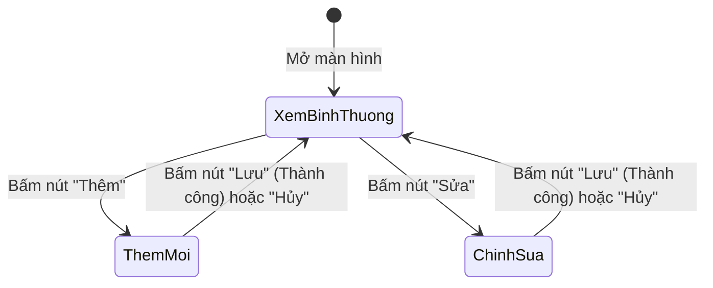

# Tài liệu Quy tắc Thiết kế Hệ thống và Giao diện (UI/UX Design Standards)

Tài liệu này quy định các tiêu chuẩn đồng bộ về giao diện, màu sắc, phông chữ, quy ước đặt tên và các mẫu bố cục màn hình cho toàn bộ 20 Form chức năng trong Hệ thống Phần mềm Quản lý Sự kiện.

---

## 1. Mục đích và nguyên tắc thiết kế đồng bộ

### 1.1. Mục đích
Khi 3 thành viên trong nhóm cùng tham gia xây dựng giao diện trên Windows Forms, việc áp dụng chung một bộ quy tắc thiết kế là bắt buộc để:
- Tránh tình trạng giao diện bị lệch pha: Mỗi người làm một kiểu màu, một cỡ chữ hoặc vị trí nút bấm lộn xộn.
- Mang lại trải nghiệm sử dụng chuyên nghiệp, hiện đại, thân thiện và đồng nhất từ màn hình đăng nhập đến các báo cáo in ấn.
- Giúp việc ghép nối mã nguồn giữa các thành viên diễn ra nhanh chóng, dễ bảo trì và dễ chấm điểm.

### 1.2. Bốn nguyên tắc thiết kế cốt lõi
1. **Rõ ràng và mạch lạc:** Mỗi màn hình chỉ tập trung vào một nhiệm vụ chính, thông tin trình bày có trật tự thị giác, mắt người dùng dễ dàng lướt qua các khu vực quan trọng.
2. **Nhất quán toàn diện:** Tất cả các màn hình danh mục đều có chung cách sắp xếp nút bấm, màu sắc và phông chữ.
3. **Phản hồi tức thì:** Mọi thao tác bấm nút, thêm mới, xóa hay lưu trữ đều phải có phản hồi rõ ràng (đổi màu viền, thông báo thành công hoặc cảnh báo lỗi cụ thể).
4. **An toàn dữ liệu:** Chặn đứng các thao tác bấm nhầm (ví dụ: nút Xóa luôn hỏi lại xác nhận, các ô nhập tự động khóa khi chưa bấm Thêm hoặc Sửa).

---

## 2. Hệ thống màu sắc và phông chữ nhận diện

### 2.1. Bảng màu thương hiệu (Color Palette)
Hệ thống sử dụng tông màu chủ đạo là xanh dương công nghệ, kết hợp với các gam màu trung tính tạo cảm giác trang nhã, hiện đại:

| Nhóm màu | Tên gọi | Mã màu Hex | Ý nghĩa & Vị trí áp dụng |
| :--- | :--- | :---: | :--- |
| **Màu chính** | Primary Blue | `#1E3A8A` | Màu thương hiệu chính: Tiêu đề ứng dụng, thanh menu điều hướng, đường viền nhấn. |
| **Màu thao tác** | Action Blue | `#2563EB` | Nút bấm hành động chính (Thêm, Lưu, Đăng nhập, In vé). |
| **Màu nền** | Neutral Light | `#F3F4F6` | Màu nền chung của các Form, tạo cảm giác dịu mắt khi làm việc lâu. |
| **Màu viền** | Border Gray | `#E5E7EB` | Màu đường kẻ phân cách khu vực, viền ô nhập liệu và viền bảng. |
| **Màu chữ chính**| Text Dark | `#1F2937` | Màu chữ nội dung, nhãn trường nhập liệu (độ tương phản cao, dễ đọc). |
| **Màu chữ phụ** | Text Muted | `#6B7280` | Màu chữ ghi chú, gợi ý trong ô nhập (Placeholder text). |

### 2.2. Bảng màu trạng thái & cảnh báo (Semantic Colors)
| Trạng thái | Mã màu Hex | Ý nghĩa & Vị trí áp dụng |
| :--- | :---: | :--- |
| **Thành công (Success)** | `#10B981` | Xanh lá cây: Báo lưu dữ liệu thành công, trạng thái "Đã thanh toán", "Đã check-in", "Hoạt động". |
| **Cảnh báo (Warning)** | `#F59E0B` | Vàng cam: Cảnh báo chi tiêu chạm mốc 80% ngân sách, trạng thái "Chờ thanh toán", "Sắp diễn ra". |
| **Nguy hiểm / Lỗi (Danger)** | `#EF4444` | Đỏ tươi: Báo lỗi nhập liệu sai, nút Xóa dữ liệu, cảnh báo quét vé gian lận, trạng thái "Đã hủy". |
| **Thông tin (Info)** | `#3B82F6` | Xanh da trời: Các chỉ số thống kê, ghi chú hướng dẫn thao tác. |

### 2.3. Quy chuẩn phông chữ (Typography)
- **Kiểu phông chuẩn:** Toàn bộ hệ thống sử dụng duy nhất phông **`Segoe UI`** (phông chữ tiêu chuẩn của Microsoft Windows, hiển thị tiếng Việt có dấu sắc nét, không bị lỗi răng cưa).
- **Phân cấp cỡ chữ:**
  - **Tiêu đề Form / Trang chủ:** Cỡ chữ `14pt` hoặc `16pt`, in đậm (`Bold`), màu `#1E3A8A`.
  - **Tiêu đề nhóm chức năng (GroupBox / Panel Header):** Cỡ chữ `11pt`, in đậm (`Bold`).
  - **Nhãn trường nhập liệu (Label):** Cỡ chữ `9.5pt` hoặc `10pt`, kiểu bình thường (`Regular`), canh lề mép trái.
  - **Chữ trong ô nhập và bảng danh sách:** Cỡ chữ `9.5pt`, kiểu bình thường (`Regular`).
  - **Ghi chú phụ / Tooltip:** Cỡ chữ `8.5pt`, in nghiêng (`Italic`), màu `#6B7280`.

---

## 3. Quy chuẩn các điều khiển nhập liệu & hiển thị (Controls)

### 3.1. Ô nhập văn bản (TextBox)
- Chiều cao chuẩn từ `26px` đến `28px`.
- Viền phẳng nhẹ màu xám `#D1D5DB`. Khi người dùng bấm chuột vào ô nhập (Focus), viền ô tự động đổi sang màu xanh `#2563EB` để báo hiệu vị trí con trỏ.
- Nếu ô nhập bị lỗi (bỏ trống hoặc sai định dạng), hiển thị biểu tượng chấm than đỏ bên cạnh thông qua `ErrorProvider` kèm thông báo giải thích ngắn gọn.

### 3.2. Nút bấm thao tác (Button)
- Chiều cao chuẩn từ `32px` đến `36px`, có độ dài chữ cân đối và viền bo nhẹ hoặc viền phẳng (Flat Style).
- **Phân loại nút bấm:**
  - **Nút chính (Primary):** Nền xanh dương `#2563EB`, chữ trắng (dành cho Thêm mới, Lưu dữ liệu, Đăng nhập, In vé).
  - **Nút phụ (Secondary):** Nền trắng hoặc xám nhạt `#F3F4F6`, viền xám, chữ đen (dành cho nút Hủy bỏ, Đóng, Làm mới).
  - **Nút nguy hiểm (Danger):** Nền đỏ `#EF4444` hoặc viền đỏ, chữ đỏ (dành cho nút Xóa, Hủy sự kiện). Luôn bật hộp thoại hỏi lại *"Bạn có chắc chắn muốn xóa không?"* trước khi thực thi.
- **Hiệu ứng chuột (Hover):** Khi rê chuột qua nút bấm, màu nền tự động chuyển sang tông màu đậm hơn 10% để tạo cảm giác xúc giác bấm trực quan.

### 3.3. Bảng hiển thị danh sách (DataGridView)
- **Bảo vệ dữ liệu:** Đặt chế độ chỉ đọc (`ReadOnly = true`) để người dùng không gõ linh tinh trực tiếp vào bảng.
- **Chọn nguyên dòng (`FullRowSelect`):** Khi bấm vào bất kỳ ô nào thì toàn bộ dòng tương ứng sẽ sáng màu xanh nhạt, giúp người dùng nhìn rõ mình đang thao tác trên đối tượng nào.
- **Dòng xen kẽ màu (`AlternatingRows`):** Dòng chẵn nền trắng `#FFFFFF`, dòng lẻ nền xám cực nhạt `#F9FAFB` giúp mắt không bị mỏi khi duyệt danh sách nhiều dòng.
- **Quy chuẩn căn lề tiêu đề & từng cột:**
  - **100% Tiêu đề cột (`HeaderCell.Style.Alignment`):** Canh chính giữa (`MiddleCenter`) để giao diện cân đối, hiện đại.
  - **Cột số thứ tự, mã định danh, ngày giờ, trạng thái, ô đánh dấu (CheckBox):** Canh ở chính giữa ô (`MiddleCenter`).
  - **Cột họ tên, tên sự kiện, nội dung, địa chỉ, mô tả:** Canh mép bên trái (`MiddleLeft`).
  - **Cột số tiền, giá vé, số lượng, điểm số, tỷ lệ %:** Canh mép bên phải (`MiddleRight`) để các chữ số hàng đơn vị thẳng cột với nhau.

### 3.4. Hộp chọn danh mục (ComboBox)
- Luôn đặt thuộc tính `DropDownStyle = DropDownList` để người dùng chỉ được chọn các mục có sẵn trong danh mục CSDL, không được tự gõ chữ lung tung.
- Bật tính năng tìm kiếm gợi ý nhanh: Khi gõ một chữ cái (ví dụ chữ "H"), danh sách tự động cuộn đến từ bắt đầu bằng chữ "H" (`AutoCompleteMode = SuggestAppend`).

### 3.5. Ô chọn ngày giờ (DateTimePicker)
- Định dạng hiển thị thống nhất theo chuẩn Việt Nam: `dd/MM/yyyy` (cho ngày tháng) hoặc `dd/MM/yyyy HH:mm` (cho lịch trình có cả giờ giấc).

---

## 4. Quy ước đặt tên điều khiển (Control Naming Conventions)

Toàn bộ các điều khiển trên 20 Form phải tuân thủ tiền tố 3 chữ cái viết thường để khi đọc code ai cũng hiểu ngay:

| Tiền tố | Loại điều khiển | Ví dụ đặt tên chuẩn |
| :---: | :--- | :--- |
| `btn` | Nút bấm (Button) | `btnThem`, `btnSua`, `btnXoa`, `btnLuu`, `btnHuy`, `btnInVe`, `btnQuetQR` |
| `txt` | Ô nhập văn bản (TextBox) | `txtMaSuKien`, `txtTenSuKien`, `txtHoTen`, `txtEmail`, `txtSoDienThoai` |
| `cbo` | Hộp chọn danh mục (ComboBox) | `cboLoaiSuKien`, `cboDiaDiem`, `cboTrangThai`, `cboHangVe` |
| `dtp` | Chọn ngày giờ (DateTimePicker) | `dtpNgayBatDau`, `dtpNgayKetThuc`, `dtpNgaySinh` |
| `dgv` | Bảng danh sách (DataGridView) | `dgvDanhSachSuKien`, `dgvHangVe`, `dgvNguoiThamGia`, `dgvChiPhi` |
| `lbl` | Nhãn tĩnh (Label) | `lblTieuDe`, `lblTongTien`, `lblSoLuongConLai` |
| `chk` | Hộp đánh dấu (CheckBox) | `chkGhiNhoDangNhap`, `chkCoQuyen` |
| `nud` | Ô tăng giảm số (NumericUpDown) | `nudSoLuongMua`, `nudSucChua` |
| `err` | Báo lỗi nhập liệu (ErrorProvider) | `errBaoLoi` |

### Nguyên tắc vàng khi viết mã Form (Code-behind)
1. **Tuyệt đối không viết câu lệnh SQL hay gọi trực tiếp `DbContext` trên Form:** Mọi thao tác đọc ghi dữ liệu đều phải gọi qua các phương thức của tầng BLL (ví dụ: `_eventService.GetAll()`, `_ticketService.Register()`).
2. **Quy trình 3 bước của một nút bấm:**
   - Bước 1: Thu thập dữ liệu từ các điều khiển và kiểm tra ô trống cơ bản.
   - Bước 2: Đóng gói dữ liệu gửi xuống tầng BLL xử lý.
   - Bước 3: Nhận `ServiceResult` trả về; nếu thành công thì thông báo và tải lại bảng dữ liệu; nếu thất bại thì báo lỗi rõ ràng.

---

## 5. Quy tắc quản lý 3 trạng thái màn hình (Screen States)

Để người dùng không bị lúng túng hoặc bấm nhầm, tất cả các màn hình quản lý danh mục phải hoạt động theo 3 trạng thái rõ ràng (`FormMode`):



### 1. Trạng thái Xem bình thường (Browse / View)
- Các ô nhập liệu bị khóa lại (`ReadOnly = true` hoặc `Enabled = false`). Khi người dùng bấm vào bảng danh sách, thông tin dòng đang chọn tự động đổ đầy lên các ô nhập.
- Các nút **Thêm**, **Sửa**, **Xóa**, **Làm mới** hiển thị sáng lên cho phép thao tác.
- **Quy tắc ẩn hiện nút Lưu/Hủy:** Cặp nút **`[Lưu]`** và **`[Hủy]`** được **ẨN HOÀN TOÀN (`Visible = false`)** khi ở chế độ Xem để giao diện gọn gàng, thoáng đãng, tránh người dùng bấm nhầm khi chưa có nhu cầu lưu dữ liệu.

### 2. Trạng thái Thêm mới (Insert)
- Khi người dùng bấm nút **Thêm**: Toàn bộ ô nhập liệu tự động xóa trắng nội dung cũ, mở khóa cho phép gõ phím, con trỏ chuột tự động đặt vào ô đầu tiên.
- Cặp nút **`[Lưu]`** và **`[Hủy]`** **HIỂN THỊ (`Visible = true`, `Enabled = true`)** để người dùng hoàn tất hoặc hủy thao tác.
- Các nút **Thêm**, **Sửa**, **Xóa** và bảng danh sách tạm thời bị mờ đi (`Enabled = false`) để người dùng tập trung hoàn thành nhập liệu.

### 3. Trạng thái Chỉnh sửa (Update)
- Khi người dùng chọn một dòng và bấm nút **Sửa**: Ô chứa **Mã số chính (Khóa chính)** bị khóa cứng tuyệt đối không cho sửa. Các ô thông tin còn lại mở khóa cho phép điều chỉnh.
- Cặp nút **`[Lưu]`** và **`[Hủy]`** **HIỂN THỊ (`Visible = true`, `Enabled = true`)** để người dùng xác nhận cập nhật hoặc hủy bỏ việc chỉnh sửa.

---

## 6. Bốn mẫu bố cục chuẩn (Layout Archetypes) cho 20 màn hình

Toàn bộ 20 Form của hệ thống được quy về 4 mẫu màn hình chuẩn mực:

### Mẫu 1 – Bố cục Trang chủ / Dashboard (Form F02)
- **Khu vực trên cùng:** Gồm 4 thẻ số liệu thống kê quan trọng (Tổng sự kiện, Tổng vé đã bán, Tổng doanh thu, Tỷ lệ check-in) với số to rõ và màu sắc trực quan, dàn đều theo bề ngang màn hình.
- **Khu vực giữa:** Biểu đồ đường hoặc cột thể hiện xu hướng tham gia sự kiện và tỷ lệ doanh thu theo thời gian (`LiveCharts2`).
- **Khu vực dưới cùng:** Danh sách các sự kiện sắp diễn ra trong 7 ngày tới kèm theo thanh lối tắt điều hướng nhanh các phân hệ nghiệp vụ (`F04`, `F11`, `F13`, `F19`).

### Mẫu 2 – Bố cục Danh sách kết hợp Nhập liệu (Áp dụng cho 10 Form danh mục: F03, F04, F06, F07, F09, F10, F12, F14, F16, F18)
- Màn hình được chia làm 2 khu vực rõ ràng:
  - **Nửa trên:** Thanh tìm kiếm nhanh, bộ lọc trạng thái và bảng danh sách dữ liệu (`DataGridView`) tự động co giãn (`AutoSizeColumnsMode = Fill`).
  - **Nửa dưới:** Khu vực các ô nhập liệu chi tiết nằm gọn trong một `GroupBox`, dưới cùng là hàng nút bấm thao tác chuẩn: `[Thêm]` `[Sửa]` `[Xóa]` `[Lưu]` `[Hủy]` `[Làm mới]`.

### Mẫu 3 – Bố cục Chi tiết nhiều thẻ TabControl (Form F05 – Chi tiết sự kiện)
- Màn hình điều phối trung tâm của toàn bộ sự kiện:
  - **Phần đầu trang (Header):** Hiển thị cố định thông tin tóm tắt của sự kiện (Tên sự kiện, Thời gian diễn ra, Địa điểm, Trạng thái, Thanh đo tiến độ ngân sách).
  - **Phần thân trang:** Sử dụng điều khiển `TabControl` gồm 9 Tab chức năng: Lịch trình, Hạng vé, Khách mời, Phân công nhân sự, Nhà tài trợ, Chi phí, Đăng ký & Điểm danh, Đánh giá, Báo cáo nhanh.

### Mẫu 4 – Bố cục Tác nghiệp đặc biệt (F01, F11, F13, F17, F19, UC21)
Được tối ưu riêng biệt cho từng luồng thao tác đặc thù:
- **Form Đăng nhập (F01) & Đổi mật khẩu (UC21):** Hộp thoại nhỏ gọn (`420 x 345`), hiển thị căn chính giữa màn hình, cố định không phóng to, có ô mật khẩu ẩn ký tự kèm CheckBox hiển thị mật khẩu.
- **Form Đăng ký & Bán vé (F11):** Bố cục 2 cột: Cột bên trái chọn sự kiện, chọn loại vé, nhập số lượng mua (1–10 vé) và danh sách người đi cùng; cột bên phải hiển thị hóa đơn tạm tính và nút xác nhận thanh toán/in vé.
- **Form Check-in quét mã QR (F13):** Dành vị trí trung tâm nổi bật cho khung hình ảnh Webcam quét mã QR tự động; bên cạnh là danh sách điểm danh thời gian thực và thanh tỷ lệ đã đến / chưa đến.
- **Form Quản lý Ngân sách & Chi phí (F17):** Tích hợp thanh đo ngân sách trực quan, tự động chuyển màu sang vàng cam khi chi vượt 80% và chuyển sang màu đỏ khi chi vượt 100% (bội chi).
- **Form Báo cáo & Thống kê (F19):** Toàn bộ màn hình dành cho khung xem trước bản in hóa đơn và báo cáo tài chính (`ReportViewer`), có các nút lọc theo khoảng ngày, nút bấm In và nút Xuất tệp Excel.

---

## 7. Chuẩn hóa Toàn màn hình Responsive & Tiêu đề Form

Để đảm bảo phần mềm vận hành trơn tru và hiển thị đẹp mắt trên máy tính của người dùng (độ phân giải 1920×1080 Full HD, 2K, 4K hoặc laptop 1366×768):

1. **Tiêu đề Form thống nhất:**
   - Thanh tiêu đề (Title Bar) của toàn bộ 20 Form đều được đặt thống nhất là: **`"Hệ Thống Quản Lý Sự Kiện"`**.
   - Tên cụ thể của từng phân hệ (ví dụ: *"Trang chủ"*, *"Quản lý tài khoản người dùng"*, *"Chi tiết sự kiện"*, *"Báo cáo thống kê"*,...) được đặt trang trọng, in hoa, phông chữ đậm tại thanh Banner (`lblTitle`) đầu trang.
2. **Khởi chạy Toàn màn hình (Maximized):**
   - Ngoại trừ Form Đăng nhập (`F01`) có kích thước cố định, tất cả các Form (F02 đến F19) đều khởi chạy mặc định ở trạng thái toàn màn hình:
     ```csharp
     this.WindowState = FormWindowState.Maximized;
     ```
   - Tự động áp dụng cơ chế Responsive Layout thông qua phương thức `ApplyResponsiveLayout()` trong lớp cơ sở `FrmBase`: Tự động neo (`Anchor`), co giãn các cột `DataGridView` lấp đầy toàn bộ bề ngang (`AutoSizeColumnsMode = Fill`), phân phối đều các thẻ KPI Card và nút tác nghiệp, không để trống bên phải hay co cụm sang bên trái màn hình.

---

## 8. Hệ thống Menu Điều hướng Tập trung (`MenuStrip`)

Từ phiên bản chuẩn hóa giao diện mới nhất, lớp Form cơ sở [`FrmBase`](file:///D:/WindowsProgramming_EventManagement/EventManagement.GUI/Forms/FrmBase.cs) đã được tích hợp sẵn thanh Menu điều hướng cấp hệ thống (`MenuStrip`), giúp người dùng chuyển đổi nhanh chóng giữa tất cả 20 Form chức năng mà không cần phải quay lại Dashboard:

- **Menu Hệ thống:**
  - Đăng nhập / Đổi tài khoản
  - Đổi mật khẩu cá nhân (`UC21`)
  - Quản lý tài khoản người dùng (`F03`)
  - Cấu hình kết nối máy chủ CSDL
  - Đăng xuất & Thoát phần mềm
- **Menu Nghiệp vụ sự kiện:**
  - Quản lý danh sách sự kiện (`F04`)
  - Đăng ký & Bán vé sự kiện (`F11`)
  - Soát vé Check-in Camera QR (`F13`)
  - Báo cáo & Thống kê tổng hợp (`F19`)
- **Menu Danh mục dùng chung:**
  - Danh mục Loại sự kiện (`F06`)
  - Danh mục Địa điểm & Hội trường (`F07`)
  - Danh mục Lịch trình & Timeline (`F08`)
  - Danh mục Diễn giả & Khách mời (`F09`)
  - Danh mục Hồ sơ người tham gia (`F10`)
  - Danh mục Hạng vé & Kho vé (`F12`)
  - Danh mục Nhân sự ban tổ chức (`F14`)
  - Phân công ca trực nhân sự (`F15`)
  - Quản lý Nhà tài trợ & Đối tác (`F16`)
  - Quản lý Chi phí & Ngân sách (`F17`)
  - Khảo sát & Phản hồi sau sự kiện (`F18`)
- **Cơ chế Phân quyền động trên MenuStrip:**
  - Tự động đồng bộ với `CurrentSession`: Người dùng thuộc vai trò nào chỉ nhìn thấy các menu nghiệp vụ mà mình có quyền truy cập (các mục vượt quyền tự động được ẩn đi nhờ `PermissionHelper.ApplyAuthorization`).
