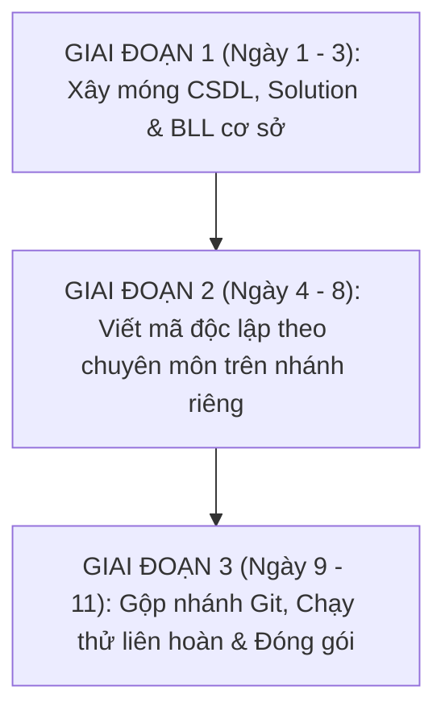

# 12. Kế hoạch Chi tiết Triển khai Dự án (1,5 Tuần)

Tài liệu này xác lập kế hoạch làm việc chi tiết, phân chia trách nhiệm và lộ trình thực hiện từng ngày cho **nhóm 3 thành viên** trong khung thời gian **1,5 tuần (11 ngày làm việc)** nhằm hoàn thành Hệ thống Phần mềm Quản lý Sự kiện (C# Windows Forms, 3-Tier, SQL Server).

---

## 1. Nguyên tắc phân công công việc & Đảm bảo công bằng

1. **Cân đối khối lượng công việc (34% - 33% - 33%):**
   - Ba thành viên có vai trò bình đẳng, cùng phối hợp và chịu trách nhiệm chung về chất lượng toàn hệ thống.
   - Khối lượng công việc được phân chia theo thế mạnh chuyên môn: Một người phụ trách hạ tầng kiến trúc & CSDL; một người chuyên trách giao diện UI/UX và các màn hình danh mục; một người chuyên trách toàn bộ thuật toán nghiệp vụ và các màn hình tác nghiệp phức tạp.
2. **Không chồng chéo mã nguồn:**
   - Mỗi người làm việc trên một nhánh Git độc lập, quản lý các Form và Service riêng biệt, hạn chế tối đa xung đột khi gộp mã nguồn (Merge Conflict).
3. **Tiêu chuẩn hoàn thành rõ ràng (Definition of Done):**
   - Mọi chức năng khi hoàn thành đều phải đạt chuẩn: Giao diện chuẩn phông `Segoe UI 9pt`, chạy đúng 3 trạng thái màn hình (Xem - Thêm - Sửa), bắt lỗi rỗng qua `ErrorProvider`, xử lý thông qua tầng BLL và lưu trữ dữ liệu an toàn vào CSDL.

---

## 2. Bảng phân chia công việc cụ thể

| Thành viên | Mảng đảm nhận | Phạm vi Form | Nhiệm vụ tổng quan cốt lõi | Tỷ lệ |
| :---: | :--- | :---: | :--- | :---: |
| **Thành viên 1** | **Kiến trúc, CSDL & Bảo mật** | **5 Form** (F01–F03, F20, UC21) | • Xây dựng CSDL 20 bảng & Dựng Solution 5 projects. • Cài đặt hạ tầng: Generic Repo, Unit of Work, CurrentSession. • Bảo mật tài khoản: Băm BCrypt, chống Brute-force (AD-7). • Thiết kế **Dashboard F02** với biểu đồ động **LiveCharts2**. | **34%** |
| **Thành viên 2** | **Giao diện UI/UX & Sự kiện** | **10 Form** (F04–F09, F14–F16, F18) | • Chuẩn hóa giao diện Segoe UI 9pt, 3 trạng thái (Xem-Thêm-Sửa). • Thiết kế 8 Form danh mục dùng chung theo Mẫu bố cục 2. • Xây dựng màn hình điều phối trung tâm: **F05 (9 Tabs)**. • Tích hợp các hàm kiểm tra nghiệp vụ từ tầng BLL vào Form. | **33%** |
| **Thành viên 3** | **Thuật toán, Bán vé & Báo cáo** | **6 Form** (F10–F13, F17, F19) | • Xây dựng trọn gói 9 thuật toán cốt lõi: Chống trùng lịch (BR-04, 06, 13)... • Bọc Transaction bán vé nhiều người (F11), Cảnh báo chi 80% (F17). • Tích hợp Webcam quét mã QR **ZXing.Net** (F13 - BR-12). • Thiết kế 2 mẫu in ấn RDLC và xuất dữ liệu Excel (F19). | **33%** |

---

## 3. Lịch trình chi tiết từng ngày (11 Ngày làm việc)

### Ngày 1: Khởi tạo Cơ sở Dữ liệu & Môi trường làm việc
* **Thành viên 1:** Viết file script tạo CSDL `01_Database_Schema.sql` (đầy đủ 20 bảng quan hệ, khóa chính, khóa ngoại, ràng buộc kiểm tra toàn vẹn) và file dữ liệu mẫu `02_SeedData.sql` (1 tài khoản Admin băm sẵn BCrypt, 3 nhóm quyền).
* **Thành viên 2:** Nghiên cứu cấu trúc dữ liệu các bảng Sự kiện và Danh mục (`LoaiSuKien`, `DiaDiem`, `DienGia`, `NhanSu`, `SuKien`); chuẩn bị bộ dữ liệu mẫu thực tế để thử nghiệm giao diện.
* **Thành viên 3:** Nghiên cứu cấu trúc dữ liệu các bảng Vé, Tài chính và Báo cáo (`HangVe`, `NguoiThamGia`, `DangKy`, `ChiTietVe`, `CheckIn`, `ChiPhiSuKien`); chuẩn bị bộ dữ liệu mẫu cho bán vé và chi phí.
* **Mục tiêu nghiệm thu:** Chạy thành công script SQL tạo trọn vẹn 20 bảng trên máy tính của cả 3 thành viên.

---

### Ngày 2: Dựng Solution Visual Studio & Tạo các lớp Model
* **Thành viên 1:** Dựng Solution Visual Studio gồm 5 Projects (`Core`, `DAL`, `BLL`, `GUI`, `Reports`). Cài đặt các thư viện NuGet: `BCrypt.Net-Next`, `LiveChartsCore.SkiaSharpView.WinForms`, `ZXing.Net`, `AForge.Video`. Viết các class nền tảng: `DbContext`, `GenericRepository<T>`, `UnitOfWork`, `ServiceResult`, `FrmBase` (cài đặt sẵn font Segoe UI 9pt). Đẩy mã nguồn lên nhánh `main`.
* **Thành viên 2:** Kéo mã nguồn nhánh `main` về máy; tạo các Entity và DTO cho phân hệ Sự kiện trong project `Core` (`SuKien`, `LoaiSuKien`, `DiaDiem`, `DienGia`, `LichTrinh`, `NhanSu`, `PhanCongNhanSu`).
* **Thành viên 3:** Kéo mã nguồn nhánh `main` về máy; tạo các Entity và DTO cho phân hệ Vé & Tài chính trong project `Core` (`HangVe`, `NguoiThamGia`, `DangKy`, `ChiTietVe`, `CheckIn`, `NhaTaiTro`, `ChiPhiSuKien`, `PhanHoi`).
* **Mục tiêu nghiệm thu:** Toàn bộ Solution Build thành công 0 lỗi trên máy cả 3 người; bắt đầu rẽ sang 3 nhánh Git riêng: `feature/member1`, `feature/member2`, `feature/member3`.

---

### Ngày 3: Bắt đầu xây dựng BLL cơ sở & Các màn hình đầu tiên
* **Thành viên 1:** Viết `AuthService` ở tầng BLL (xác thực mật khẩu BCrypt, cơ chế kiểm soát thử sai chống Brute-force theo AD-7, nạp phiên `CurrentSession`). Dựng giao diện Form **F01 (Đăng nhập)** và Dialog **UC21 (Đổi mật khẩu)**.
* **Thành viên 2:** Dựng giao diện Form **F06 (Quản lý loại sự kiện)** và **F07 (Quản lý địa điểm)** theo đúng Mẫu 2 và chuẩn 3 trạng thái màn hình (Xem - Thêm - Sửa).
* **Thành viên 3:** Viết 2 thuật toán kiểm tra thời gian sự kiện: **BR-03** ($End\_Date \ge Start\_Date$) và **BR-05** (Lịch trình con nằm trong khung giờ sự kiện chính). Dựng Form **F10 (Quản lý người tham gia)**.
* **Mục tiêu nghiệm thu:** Đăng nhập F01 thành công vào hệ thống; các form F06, F07, F10 thêm/sửa/xóa dữ liệu mượt mà.

---

### Ngày 4: Hoàn thành các Form danh mục dùng chung
* **Thành viên 1:** Xây dựng Form **F03 (Quản lý tài khoản NguoiDung)**: Cung cấp đầy đủ tính năng thêm, sửa, khóa tài khoản và nút thao tác *"Mở khóa tài khoản"* cho phép khôi phục tức thì các tài khoản bị khóa do Brute-force.
* **Thành viên 2:** Xây dựng tiếp 2 màn hình danh mục: **F09 (Quản lý diễn giả / khách mời)** và **F14 (Quản lý nhân sự)**.
* **Thành viên 3:** Viết thuật toán **BR-04 (Chống trùng lịch địa điểm)** kiểm tra giao thoa thời gian giữa các sự kiện. Xây dựng Form **F12 (Quản lý các hạng vé)**.
* **Mục tiêu nghiệm thu:** Hoàn tất 100% các Form danh mục cơ sở; thuật toán chống trùng địa điểm BR-04 hoạt động chính xác.

---

### Ngày 5: Thuật toán xung đột lịch trình & Phân hệ Tài chính
* **Thành viên 1:** Xây dựng Form **F20 (Quản lý nhóm quyền & Phân quyền)**: Hiện thực hóa bảng phân quyền ma trận động trên bảng `PhanQuyen`.
* **Thành viên 2:** Xây dựng Form **F16 (Quản lý nhà tài trợ)** và **F18 (Quản lý phản hồi)** (áp dụng khung Mẫu 2 đã dựng ở ngày 3-4).
* **Thành viên 3:** 
  - Viết thuật toán **BR-06 (Chống trùng diễn giả và trùng phòng chức năng)** và **BR-13 (Chống trùng ca trực nhân sự)**.
  - Viết logic BLL quản lý ngân sách và thuật toán kích hoạt cảnh báo đổi màu giao diện khi thực chi chạm ngưỡng 80% (BR-15).
* **Mục tiêu nghiệm thu:** Bàn giao các hàm kiểm tra trùng lịch (BR-04, BR-06, BR-13) cho Thành viên 2 nhúng vào Form Sự kiện; Thành viên 2 hoàn thành giao diện F16, F18.

---

### Ngày 6: Điều phối Lịch trình, Ca trực & Tác nghiệp Bán vé
* **Thành viên 1:** Cấu hình cơ chế đọc/ghi chuỗi kết nối động `App.config` lúc khởi động (AD-6). Cài đặt bộ bắt lỗi toàn cục `GlobalExceptionHandler` để ứng dụng không bị vỡ giao diện khi gặp lỗi bất ngờ.
* **Thành viên 2:** Nhúng các thuật toán của Thành viên 3 vào Form: Xây dựng Form **F08 (Lịch trình tiết mục)** (dùng BR-05, BR-06) và Form **F15 (Phân công nhân sự theo ca trực)** (dùng BR-13).
* **Thành viên 3:** Xây dựng màn hình **F11 (Đăng ký & Bán vé)**:
  - Bọc toàn bộ nghiệp vụ trong `SqlTransaction` (BR-18).
  - Cho phép chọn số lượng mua từ 1 đến 10 vé (BR-10), tính tiền, trừ tồn kho khả dụng (BR-09).
  - Tự động sinh $N$ vé con trong `ChiTietVe`, mỗi vé có mã QR GUID duy nhất (`MaQR UNIQUE`) và lưu tên người tham dự tương ứng.
* **Mục tiêu nghiệm thu:** Bán vé F11 thành công, kiểm tra CSDL thấy kho vé tự động trừ số lượng và sinh đủ các vé con có mã QR độc lập.

---

### Ngày 7: Quét mã QR Webcam, Sự kiện tổng thể & Khởi dựng Dashboard
* **Thành viên 1:** Bắt đầu dựng Form **F02 (Trang chủ / Dashboard)**: Cài đặt thư viện `LiveCharts2`, thiết kế 4 thẻ số liệu thống kê ở khu vực trên cùng.
* **Thành viên 2:** Xây dựng Form **F04 (Danh sách sự kiện tổng thể)**: Tích hợp thanh tìm kiếm đa điều kiện, lọc theo loại sự kiện và trạng thái sự kiện.
* **Thành viên 3:** Xây dựng Form **F13 (Check-in sự kiện)**:
  - Kết nối Webcam qua thư viện `AForge` và giải mã mã QR tức thì bằng `ZXing.Net`.
  - Kiểm tra điều kiện vé hợp lệ (BR-11), chặn quét vé gian lận 1 chiều (BR-12 - vé quét lần 2 báo đỏ cảnh báo).
* **Mục tiêu nghiệm thu:** Đưa camera quét thử mã QR hiển thị trên màn hình điện thoại $\to$ Form F13 nhận diện vé thành công trong vòng 1 giây; quét lại lần 2 lập tức báo lỗi gian lận.

---

### Ngày 8: Hoàn thiện Form F05 (9 Tabs), Form F17 & Mẫu in RDLC
* **Thành viên 1:** Hoàn thiện Form **F02 (Dashboard)**: Dùng `LiveCharts2` vẽ biểu đồ cột doanh thu theo sự kiện, biểu đồ tròn tỷ lệ check-in thực tế và danh sách sự kiện sắp diễn ra trong tuần.
* **Thành viên 2:** Xây dựng màn hình điều phối trung tâm phức tạp nhất đề án: **F05 (Chi tiết sự kiện - 9 Tabs)**, liên kết toàn bộ dữ liệu Sự kiện, Lịch trình, Hạng vé, Nhân sự, Khách mời, Tài trợ và Chi phí.
* **Thành viên 3:**
  - Xây dựng Form **F17 (Ngân sách & Chi phí)**: Hiển thị thanh đo ngân sách tự động đổi sang màu vàng cam khi chi chạm mốc 80% (BR-15).
  - Xây dựng Form **F19 (Báo cáo & Thống kê)**: Thiết kế 2 mẫu in RDLC (`VeDienTu.rdlc` in vé có ảnh QR và `BaoCaoQuyetToan.rdlc` báo cáo tài chính) + Nút xuất dữ liệu ra tệp Excel.
* **Mục tiêu nghiệm thu:** Hoàn thành 100% việc viết mã độc lập của toàn bộ 20 Form và 2 Mẫu in RDLC trên 3 nhánh Git.

---

### Ngày 9: Tích hợp toàn hệ thống & Rà soát xung đột Git
* **Cả 3 thành viên:**
  - Lần lượt tạo Pull Request gộp mã nguồn từ 3 nhánh `feature` vào nhánh chính `main`.
  - Cả nhóm cùng ngồi lại đối chiếu, giải quyết triệt để các xung đột tệp dự án (`.csproj`, `App.config`).
  - Kiểm tra đảm bảo toàn bộ Solution Build thành công với kết quả **`0 Errors`**.
  - Kiểm tra luồng gọi form chéo giữa các phân hệ: Từ Dashboard (TV1) mở nhanh được Sự kiện (TV2), Bán vé và Báo cáo (TV3).
* **Mục tiêu nghiệm thu:** Nhánh `main` chứa đầy đủ mã nguồn hoàn chỉnh của toàn bộ 20 Form, chạy thông suốt trên máy cả 3 người.

---

### Ngày 10: Chạy thử nghiệm luồng nghiệp vụ liên hoàn từ A đến Z
* **Cả 3 thành viên cùng phối hợp chạy một kịch bản sự kiện thực tế:**
  1. Đăng nhập tài khoản Manager tại F01 $\to$ Tạo sự kiện "Hội thảo Công nghệ 2026" tại F04 $\to$ Chọn địa điểm tại F07 $\to$ Thử xếp trùng giờ với sự kiện khác để xem thuật toán BR-04 có chặn không.
  2. Mở F05 tạo lịch trình tại Tab Lịch trình $\to$ Thử gán trùng giờ 1 diễn giả tại 2 phòng để kiểm tra thuật toán BR-06.
  3. Mở F12 tạo hạng vé VIP và Standard.
  4. Mở F11 bán 3 vé cho khách hàng $\to$ Kiểm tra kho vé trừ đúng 3 vé $\to$ Nhấn "In vé" mở ReportViewer in vé điện tử RDLC kèm mã QR.
  5. Mở F13 bật Webcam quét thử mã QR trên vé vừa in $\to$ Hệ thống báo check-in thành công và tăng tỷ lệ điểm danh tức thì trên Dashboard F02.
  6. Mở F17 nhập phiếu chi vượt 80% ngân sách $\to$ Kiểm tra thanh tiến độ có tự động đổi sang màu vàng cam hay không $\to$ Mở F19 in báo cáo quyết toán và xuất tệp Excel.
* **Mục tiêu nghiệm thu:** Phát hiện và sửa sạch các lỗi nhỏ phát sinh; đảm bảo dữ liệu ghi nhận vào CSDL trơn tru và chính xác 100%.

---

### Ngày 11: Tinh chỉnh giao diện Segoe UI, Đóng gói & Chuẩn bị Báo cáo
* **Thành viên 1:** Rà soát lại toàn bộ tài liệu, kiểm tra các thiết lập bảo mật và đóng gói bản phát hành (`Release.zip`) gồm tệp thực thi `.exe` và file hướng dẫn cài đặt CSDL.
* **Thành viên 2:** Kiểm tra lại tính đồng nhất giao diện trên toàn bộ 20 Form: Đúng phông chữ `Segoe UI 9pt`, canh lề chuẩn DataGridView, màu sắc nút bấm đúng bảng màu nhận diện; chuẩn bị các slide thuyết trình về phần Thiết kế Giao diện và Quản lý Sự kiện.
* **Thành viên 3:** Kiểm tra lại 9 thuật toán và 2 mẫu in RDLC; chuẩn bị các slide thuyết trình và chuẩn bị sẵn kịch bản demo (mã QR mẫu, kịch bản quét webcam trực tiếp) để gây ấn tượng mạnh với giảng viên.
* **Mục tiêu nghiệm thu:** Sản phẩm hoàn thiện 100%, sẵn sàng tự tin bước vào buổi chấm thi bảo vệ đề án.

---

## 4. Kế hoạch phối hợp hàng ngày & Kiểm soát rủi ro

1. **Giao tiếp đầu ngày (Daily Sync 10 phút):**
   - Mỗi sáng, 3 thành viên nhắn tin hoặc trao đổi nhanh: *Hôm qua đã xong phần nào? Hôm nay làm gì? Có cần người khác cấp DTO hoặc hàm Service nào không?*
2. **Quy tắc làm việc trên Git:**
   - Tuyệt đối không ai commit thẳng vào nhánh `main`.
   - Mỗi người chỉ viết mã trong phạm vi các Form và Service được phân công. Khi cần gọi hàm của nhau, thống nhất tên hàm và kiểu dữ liệu trả về trước khi viết.
3. **Kế hoạch dự phòng rủi ro:**
   - *Nếu webcam bị lỗi phần cứng trên máy demo:* Form F13 có sẵn ô nhập mã vé thủ công để dự phòng, đảm bảo buổi demo không bao giờ bị gián đoạn.
   - *Nếu gặp lỗi cài đặt ReportViewer trên máy chấm thi:* File xuất dữ liệu Excel trên F19 đóng vai trò là phương án dự phòng hoàn hảo cho phần xuất báo cáo.
