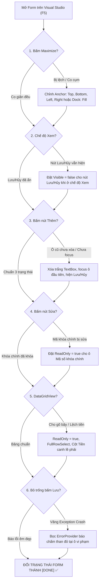

# 14. Bảng Theo Dõi Kiểm Thử & Chuẩn Hóa Giao Diện Theo Từng Thành Viên

Tài liệu này phân chia chi tiết trách nhiệm kiểm thử, rà soát và chuẩn hóa giao diện cho **từng thành viên** trong nhóm (21 Form nghiệp vụ) theo đúng cấu trúc của bảng theo dõi tiến độ dự án, áp dụng 2 trạng thái chính thức: **`DONE`** (Đã nghiệm thu giao diện đạt chuẩn) hoặc **`NOT DONE`** (Chưa hoàn thành kiểm thử giao diện).

---

## 1. Bảng Tổng Quan Tiến Độ Kiểm Thử Giao Diện Theo Thành Viên

| Thành viên | Mảng chuyên trách | Phạm vi Form | Số Form DONE | Số Form NOT DONE | Tỷ lệ hoàn thành UI | Đánh giá tổng quan |
| :--- | :--- | :---: | :---: | :---: | :---: | :--- |
| **Thành viên 1** | **Kiến trúc, Hệ thống & Bảo mật** | 5 Form | 5 Form | 0 Form | **100.0%** | 🟢 **Hoàn thành 100% chuẩn hóa & kiểm thử UI: F01, F02, F03, UC21, AD-6** |
| **Thành viên 2** | **Giao diện UI/UX & Sự kiện** | 10 Form | 5 Form | 5 Form | **50.0%** | 🟢 Đã hoàn thành F04, F05 (9 Tabs), F06, F07, F08; đang hoàn thiện các Form danh mục còn lại |
| **Thành viên 3** | **Bán vé, Soát vé, Tài chính & Báo cáo** | 6 Form | 4 Form | 2 Form | **66.7%** | 🟢 Đã hoàn thành F10, F11, F12, F19 (Báo cáo thống kê & In ấn); đang hoàn thiện F13, F17 |
| **TOÀN ĐỘI NGŨ** | **Hệ Thống Quản Lý Sự Kiện** | **21 Form** | **14 Form** | **7 Form** | **66.7%** | 🚀 **Thành viên 1 hoàn tất (5/5); TV2 hoàn thành 5/10; TV3 hoàn thành 4/6; tiến độ toàn nhóm đạt 66.7%** |

---

## 2. Chi Tiết Nhiệm Vụ Kiểm Thử & Chuẩn Hóa Theo Từng Thành Viên

### 👤 THÀNH VIÊN 1: PHÂN HỆ KIẾN TRÚC, HỆ THỐNG & BẢO MẬT (5 FORM)

| Mã Form | Tên Màn hình | File mã nguồn | Nội dung chi tiết cần xem xét & chỉnh sửa giao diện | Tiêu chí nghiệm thu cốt lõi | Trạng thái |
| :---: | :--- | :--- | :--- | :--- | :---: |
| **F01** | Đăng nhập hệ thống | `FrmLogin.cs` | • Cố định kích thước cửa sổ (`420 x 345`), hiển thị chính giữa màn hình (`CenterScreen`), khóa nút phóng to (`MaximizeBox = false`). • Kiểm tra CheckBox "Hiện mật khẩu": tích chọn thì hiện chữ thật, bỏ tích thì hiện dấu chấm tròn `•`. • Gõ sai mật khẩu 5 lần: nhãn đỏ cảnh báo đếm ngược giây nhảy đều, nút Đăng nhập tự động khóa. • Phím Enter tại ô Password tự động kích hoạt Đăng nhập. | Chống Brute-force hoạt động mượt mà, không văng lỗi khi nhập sai | `DONE` |
| **F02** | Trang chủ / Dashboard | `FrmDashboard.cs` | • Góc trên bên phải thanh Header có nút **🔄 Làm mới (F5)** xanh dương nổi bật, có hiệu ứng con trỏ Hand. • Nhấn phím `F5`: toàn bộ 4 thẻ KPI, 2 biểu đồ (`LiveCharts`) và bảng sự kiện tự động cập nhật số liệu mới nhất. • Đã ẩn dải 8 nút điều hướng xám dư thừa (`pnlQuickAccess`), giải phóng 48px chiều cao giúp biểu đồ và bảng dữ liệu hiển thị trọn vẹn không cần cuộn. • Double-click một dòng sự kiện mở chính xác Form F05 chi tiết. | Giao diện hiện đại, thoáng đãng, phím tắt F5 hoạt động 100% | `DONE` |
| **F03** | Quản lý người dùng | `FrmUserManagement.cs` | • **Ẩn cột băm mật khẩu:** Cột mật khẩu trên `DataGridView` tuyệt đối không được lộ chuỗi hash BCrypt (chỉ hiện `******` hoặc ẩn hẳn cột này đi). • Nút **"Mở khóa tài khoản"**: Mở khóa tức thì cho các user đang bị khóa tạm thời do nhập sai pass quá 5 lần. • Thử xóa tài khoản `admin`: Phải bị chặn đứng kèm thông báo *"Không thể xóa tài khoản Quản trị viên tối cao!"*. • ComboBox Vai trò: Chỉ cho chọn 3 nhóm chuẩn: `ADMIN`, `MANAGER`, `STAFF` (`DropDownList`). • **Xử lý bất đồng bộ triệt để:** Bổ sung cờ `_isInitializing` và `_isLoading` ngăn chặn xung đột đa luồng DbContext khi khởi tạo form và lọc dữ liệu. | Bảo mật thông tin mật khẩu, phân quyền quản trị chuẩn xác, xử lý triệt để race condition đa luồng | `DONE` |
| **UC21** | Đổi mật khẩu cá nhân | `FrmChangePassword.cs` | • Hộp thoại nhỏ gọn căn giữa màn hình (`460 x 420`), cố định kích thước (`FixedDialog`), không bị bung full màn hình làm trống trải. • Hàng nút Cập nhật và Hủy bỏ có khoảng cách lề đáy thoáng đãng (39px), không bị sát mép cửa sổ. • Nhập mật khẩu mới trùng mật khẩu cũ: Bắt buộc báo lỗi yêu cầu nhập mật khẩu khác. • Ô "Xác nhận" không khớp ô "Mới": Kích hoạt `ErrorProvider` báo chấm than đỏ. • Mật khẩu mới phải có độ dài từ 6 ký tự trở lên. | Thẩm định mật khẩu chặt chẽ, không cho đặt lại mật khẩu cũ, giao diện dialog chuẩn đẹp | `DONE` |
| **AD-6** | Cấu hình máy chủ CSDL | `FrmServerConfig.cs` | • Hộp thoại nhỏ gọn căn giữa màn hình (`520 x 445`), khóa nút phóng to (`MaximizeBox = false`), viền cố định (`FixedDialog`). • Cụm nút Thử kết nối, Lưu & Khởi động, Đóng căn giữa cân đối (lề 2 bên 50px), lề đáy thoáng đãng (39px); hiển thị đúng ký tự `&`. • Hỗ trợ cả 2 chế độ: Windows Authentication và SQL Server Authentication. • Bấm nút "Kiểm tra kết nối" (Test Connection): kết nối thành công với `.\SQLEXPRESS` hoặc `.` trong vòng 3 giây. • Nút "Lưu cấu hình": Tự động cập nhật chuỗi kết nối vào file `App.config` an toàn. | Khởi chạy độc lập với cờ `--server-config`, lưu cấu hình tự động, dialog vừa vặn | `DONE` |

---

### 👤 THÀNH VIÊN 2: PHÂN HỆ SỰ KIỆN & DANH MỤC MASTER-DETAIL (10 FORM)

| Mã Form | Tên Màn hình | File mã nguồn | Nội dung chi tiết cần xem xét & chỉnh sửa giao diện | Tiêu chí nghiệm thu cốt lõi | Trạng thái |
| :---: | :--- | :--- | :--- | :--- | :---: |
| **F04** | Danh sách sự kiện tổng thể | `FrmEventList.cs` | • Căn chỉnh lề tiêu đề: Dịch chuyển `lblTitle` xuống `Location = (16, 16)` giữa thanh Header (cao 58px), cân đối lề trên dưới sau khi ẩn thanh phụ đề. • Ô tìm kiếm theo Tên sự kiện: gõ đến đâu lọc bảng đến đó (`TextChanged`). • ComboBox lọc Trạng thái: Tất cả, Chuẩn bị, Sắp diễn ra, Đang diễn ra, Đã hoàn thành, Đã hủy. • Double-click dòng hoặc bấm nút "Chi tiết": Chuyển tiếp mượt sang Form F05. • Cột Ngày bắt đầu/kết thúc canh giữa; cột Ngân sách dự kiến canh lề phải kèm dấu phẩy phân cách hàng nghìn. | Bố cục co giãn đều khi Maximize, lọc trạng thái tức thì, tiêu đề Header căn giữa hoàn hảo | `DONE` |
| **F05** | Chi tiết sự kiện (9 Tabs) | `FrmEventDetail.cs` | ⭐ **Màn hình điều phối trung tâm phức tạp nhất dự án:** • Căn chỉnh lề tiêu đề: Dịch chuyển `lblTitle` xuống `Location = (16, 19)` giữa thanh Header (cao 62px), cân đối lề trên dưới. • Khắc phục triệt để lỗi cắt chữ trên thanh Tab: Đặt `SizeMode = Normal` kèm `Padding = (14, 8)` giúp hiển thị trọn vẹn 100% chữ và icon của đủ 9 Tab chức năng. • Chuẩn hóa tiêu đề bảng DataGridView: Đặt `ColumnHeadersHeight = 36`, nền Navy Blue `#1E3A8A`, chữ trắng in đậm, hiển thị rõ nét trên cả 8 bảng dữ liệu. • Chặn triệt để sinh cột rác: Khóa `AutoGenerateColumns = false` trên tất cả 8 bảng, không còn lòi cột file ảnh, tiểu sử thô hoặc số tiền chưa định dạng. • Khắc phục lỗi Mnemonic: Đặt `UseMnemonic = false` hiển thị đúng ký tự `&` trên các thanh tiêu đề phân hệ; bổ sung nút "Quản lý hạng vé" trên Tab 5. • Nút "In báo cáo sự kiện": Liên kết mở form báo cáo F19. | 9 Tab chuyển đổi mượt mà không cắt chữ, tiêu đề bảng Navy đậm nét, số liệu chuẩn hóa | `DONE` |
| **F06** | Quản lý loại sự kiện | `FrmEventType.cs` | • Bố cục chuẩn Mẫu 2: Nửa trên là bảng danh sách, nửa dưới là GroupBox nhập liệu (Mã loại, Tên loại, Mô tả). • Căn chỉnh lề tiêu đề: Dịch chuyển `lblTitle` xuống `Location = (18, 15)` giữa thanh Header (cao 52px). • Khắc phục triệt để lỗi thanh lọc bị đè lấn: Tự động điều chỉnh khoảng cách `pnlFilter` cách đáy Header 10px và bảng dữ liệu cách đáy thanh lọc 10px, không còn bị trồi đè lên tiêu đề. • Chuẩn hóa bảng dữ liệu: Loại bỏ màu bôi xanh đậm ở tiêu đề cột đầu tiên (`SelectionBackColor`), khóa độ rộng cột ngắn và cho cột Mô tả co giãn `Fill` không bị cắt chữ (`...`), thêm viền phẳng `FixedSingle`. • Quy tắc 3 trạng thái: Ẩn nút Lưu/Hủy ở chế độ Xem (`Visible = false`), chỉ hiển thị khi Thêm/Sửa, căn chỉnh vị trí nút Lưu/Hủy nối tiếp ngay ngắn cách nút Xóa 10px. • Ràng buộc toàn vẹn: Cảnh báo không cho xóa loại sự kiện nếu đã có sự kiện áp dụng loại này. | Chuẩn Mẫu 2, hết lỗi đè thanh lọc, không cắt chữ, co giãn Full HD hoàn hảo | `DONE` |
| **F07** | Quản lý địa điểm tổ chức | `FrmVenue.cs` | • Căn chỉnh lề tiêu đề: Dịch chuyển `lblTitle` xuống `Location = (18, 15)` giữa thanh Header (cao 52px). • Khắc phục triệt để lỗi thanh lọc bị đè lấn: Tự động điều chỉnh khoảng cách `pnlFilter` cách đáy Header 10px và bảng dữ liệu cách đáy thanh lọc 10px, không bị trồi đè. • Chuẩn hóa bảng dữ liệu: Loại bỏ màu bôi xanh đậm ở tiêu đề cột đầu tiên (`SelectionBackColor`), tăng độ rộng cột Tên địa điểm (250px) và Địa chỉ chi tiết (`Fill`) hiển thị trọn vẹn không bị cắt chữ (`...`), thêm viền phẳng `FixedSingle`. • Quy tắc 3 trạng thái: Ẩn nút Lưu/Hủy ở chế độ Xem (`Visible = false`), chỉ hiển thị khi Thêm/Sửa, căn chỉnh vị trí nút Lưu/Hủy nối tiếp ngay ngắn cách nút Xóa 10px. • Kiểm soát dữ liệu: Sức chứa tối đa dùng `NumericUpDown`, kiểm tra định dạng Số điện thoại bằng Regex. • Ràng buộc: Cảnh báo khi xóa địa điểm đang được lên lịch cho sự kiện sắp diễn ra. | Kiểm soát dữ liệu chặt chẽ, hết lỗi đè thanh lọc, hiển thị trọn vẹn thông tin | `DONE` |
| **F08** | Quản lý lịch trình sự kiện | `FrmSchedule.cs` | • Căn chỉnh lề tiêu đề: Dịch chuyển `lblTitle` xuống `Location = (18, 14)` giữa thanh Header (cao 54px). • Khắc phục triệt để lỗi thanh lọc bị đè lấn: Tự động điều chỉnh khoảng cách `pnlFilter` cách đáy Header 10px và bảng dữ liệu cách đáy thanh lọc 10px, bảo vệ tiêu đề và icon không bị che lấp. • Tối ưu bề rộng cột: Mở rộng các cột Sự kiện (260px), Tên tiết mục (320px), Phòng (220px), Ghi chú (`Fill`, tối thiểu 200px) đọc rõ trọn vẹn không bị cắt chữ (`...`), thêm viền phẳng `FixedSingle`. • Chuẩn hóa vị trí nút bấm: Đưa nút `[Lưu]` và `[Hủy]` về cụm nút bên trái tiếp sau nút `[Xuất Excel]`, khoảng cách đều 10-15px thuận tiện thao tác. • Chuẩn hóa căn lề: Mã lịch, Ngày, Khung giờ căn giữa; Sự kiện, Tiết mục, Phòng, Diễn giả căn trái. • Kiểm tra xung đột tự động (BR-05 & BR-06): Tự động phát hiện trùng phòng chức năng và trùng lịch diễn giả trong thời gian thực. | Hết lỗi đè thanh lọc, đọc trọn vẹn sự kiện và tiết mục, chặn trùng lịch chuẩn xác | `DONE` |
| **F09** | Quản lý diễn giả & Khách mời | `FrmSpeaker.cs` | • Có ô hiển thị ảnh đại diện chân dung (`PictureBox`, `SizeMode = Zoom`). Nếu chưa có ảnh thì hiển thị avatar mặc định trang nhã, không để ô vuông rỗng. • Ô Email: Kiểm tra định dạng email hợp lệ qua Regex. • Ô Tiểu sử tóm tắt: Dùng TextBox nhiều dòng có thanh cuộn dọc (`Multiline = true`). | Quản lý ảnh mượt mà, thẩm định email/SĐT chuẩn | `NOT DONE` |
| **F14** | Danh mục nhân sự nội bộ | `FrmStaff.cs` | • Quản lý nhân viên: Mã nhân sự, Họ tên, Chức vụ, Số điện thoại, Email, Kỹ năng chuyên môn. • Bảng danh sách hiển thị rõ nhãn trạng thái: "Đang rảnh / Sẵn sàng" (chữ xanh lá) hoặc "Đang bận ca trực" (chữ vàng cam). | Phân biệt trực quan trạng thái sẵn sàng của nhân viên | `NOT DONE` |
| **F15** | Phân công ca trực nhân sự | `FrmStaffAssignment.cs` | • Bố cục chọn Sự kiện $\to$ Chọn Nhân sự $\to$ Nhập vị trí ca trực (Soát vé, Hướng dẫn đại biểu, Điều phối kỹ thuật). • Kiểm tra thuật toán chống trùng ca trực (BR-13): Ngăn chặn xếp 1 nhân sự vào 2 sự kiện khác nhau trong cùng một khung giờ. | Chặn xung đột ca trực tuyệt đối từ tầng giao diện | `NOT DONE` |
| **F16** | Nhà tài trợ & Gói tài trợ | `FrmSponsor.cs` | • ComboBox chọn Gói tài trợ: Kim Cương, Vàng, Bạc, Đồng. • Cột "Số tiền tài trợ": Định dạng tiền tệ có dấu phẩy phân cách hàng nghìn (ví dụ: `100,000,000 VNĐ`), canh lề phải ô. • Có ô hiển thị Logo nhà tài trợ. | Định dạng tiền tệ rõ ràng, lề phải ngay ngắn | `NOT DONE` |
| **F18** | Khảo sát & Phản hồi sự kiện | `FrmFeedback.cs` | • Điểm đánh giá (Rating): từ 1 đến 5 sao (sử dụng ComboBox 1-5 sao hoặc NumericUpDown). • Ô "Nội dung góp ý": TextBox nhiều dòng (`Multiline = true`, `ScrollBars = Vertical`). • Thống kê điểm trung bình của sự kiện hiển thị to rõ phía trên bảng. | Ghi nhận phản hồi đại biểu chính xác, dễ thao tác | `NOT DONE` |

---

### 👤 THÀNH VIÊN 3: NGHIỆP VỤ BÁN VÉ, SOÁT VÉ QR, TÀI CHÍNH & BÁO CÁO (6 FORM)

| Mã Form | Tên Màn hình | File mã nguồn | Nội dung chi tiết cần xem xét & chỉnh sửa giao diện | Tiêu chí nghiệm thu cốt lõi | Trạng thái |
| :---: | :--- | :--- | :--- | :--- | :---: |
| **F10** | Hồ sơ người tham dự | `FrmAttendee.cs` | • Quản lý thông tin đại biểu: Họ tên, Giới tính (Radio Nam/Nữ), Ngày sinh (`dd/MM/yyyy`), Số điện thoại, Email, Cơ quan công tác. • Khu vực tra cứu lịch sử: Bấm chọn một người tham dự $\to$ bảng phụ hiển thị danh sách các sự kiện người này từng mua vé và trạng thái đã check-in hay chưa. | Xem lịch sử tham gia sự kiện của từng cá nhân nhanh chóng | `DONE` |
| **F11** | Đăng ký & Bán vé sự kiện | `FrmTicketOrder.cs` | ⭐ **Màn hình nghiệp vụ tác nghiệp cốt lõi của TV3:** • Bố cục 2 cột chuyên nghiệp: Cột trái chọn sự kiện, chọn hạng vé, chọn người mua, nhập số lượng mua (1–10 vé). Cột phải hiển thị hóa đơn tạm tính. • Thay đổi số lượng vé: Tổng tiền tự động nhảy số theo thời gian thực. • Kiểm tra Transaction: Mua vé thành công $\to$ số lượng vé còn lại trong kho (`HangVe.SoLuongConLai`) phải lập tức tự động trừ đi. • Sau khi lưu: Có nút "In vé điện tử" mở hộp thoại hiển thị trực quan vé điện tử kèm mã QR độ nét cao, hỗ trợ lưu ảnh QR (.png) hoặc xuất file text (.txt). Đồng bộ chuẩn xác danh sách người tham dự. | Tính tiền thời gian thực, trừ kho vé chính xác tuyệt đối, hiển thị mã QR trực quan | `DONE` |
| **F12** | Quản lý các hạng vé | `FrmTicketTier.cs` | • Quản lý hạng vé chuẩn hóa (VIP, Standard, Early Bird): Tên hạng vé, Giá vé, Số lượng phát hành, Số lượng đã bán, Số lượng còn lại. • Phân nhóm hiển thị: Các vé đang/sắp mở bán được xếp ưu tiên lên đầu bảng trước các vé đã đóng bán. • Cột Đơn giá và các thông tin mã/ngày tháng/số lượng căn lề chuẩn mực; mở rộng nút "Lưu dữ liệu" chống cụt chữ. • Ràng buộc BR-08: Không cho sửa giảm số lượng mở bán nhỏ hơn số vé đã thực tế bán ra cho khách. Nút CRUD được kiểm soát trạng thái tương tác an toàn. | Phân nhóm mở bán ưu tiên, ràng buộc tồn kho chính xác, layout chuẩn Mẫu 2 | `DONE` |
| **F13** | Soát vé qua Webcam QR | `FrmCheckInCamera.cs` | ⭐ **Tính năng điểm cộng công nghệ cao (ZXing / AForge):** • ComboBox chọn thiết bị Webcam máy tính; 2 nút "Bật Camera" và "Tắt Camera". Khung quét trực tiếp hiển thị hình ảnh webcam mượt mà không đơ giật. • Quét vé hợp lệ: Viền đổi màu xanh lá, phát âm thanh bíp và hiển thị thông tin vé, ghi nhận giờ check-in. • **Test chống gian lận (BR-12):** Quét lại cùng mã QR lần thứ 2 $\to$ Đổi viền màu đỏ kèm cảnh báo: *"CẢNH BÁO: Vé đã được check-in vào lúc HH:mm! Nghi vấn vé sao chép"*. | Quét QR webcam nhạy, cảnh báo vé trùng lập tức | `NOT DONE` |
| **F17** | Ngân sách & Quản lý chi phí | `FrmBudgetExpense.cs` | • Bảng danh mục các khoản chi: Khoản chi, Người chi, Số tiền, Hóa đơn chứng từ đính kèm. • **Test nghiệp vụ cảnh báo chi tiêu (BR-14):** Khi tổng chi phí vượt quá **80% ngân sách dự kiến** $\to$ Thanh tiến độ ngân sách tự động đổi sang màu vàng/đỏ cảnh báo nguy cơ bội chi. • Cột số tiền canh lề phải, định dạng `###,### VNĐ`. | Cảnh báo bội chi trực quan khi vượt ngưỡng 80% | `NOT DONE` |
| **F19** | Báo cáo thống kê & In ấn | `FrmReportStatistics.cs` | • Bộ lọc thời gian: Từ ngày... đến ngày... (`DateTimePicker`), ComboBox chọn Sự kiện. • Nút **"Xuất Excel (Ctrl+E)"**: Xuất báo cáo ra định dạng CSV tương thích 100% với Microsoft Excel, kèm mã hóa UTF-8 BOM chuẩn font tiếng Việt có dấu, định dạng cột tiền tệ `###,### VNĐ`. • Cân đối độ rộng các cột DataGridView (cột hẹp như STT/Mã/Ngày/Người chi, cột rộng như Khoản mục chi/Nội dung/Tên sự kiện/Địa điểm), chống cắt cụt chữ `...`. • Chuẩn hóa tiêu đề `Bộ lọc & Tùy chọn báo cáo`, xê dịch khoảng cách tránh sát mép trên, căn giữa chữ trên nút bấm. • Mẫu in phiếu/báo cáo doanh thu (PrintPreview / GDI+): Căn lề cột trang in A4 chuẩn xác, cắt tỉa văn bản chống tràn chữ. | Xuất file Excel chuẩn font tiếng Việt, giao diện chuẩn hóa cân đối, mẫu in hóa đơn sắc nét | `DONE` |

---

## 3. Checklist 6 Tiêu Chuẩn Vàng Cần Soi Khi Mở Từng Form

---

## 4. Hướng Dẫn Cập Nhật Tiến Độ Làm Việc Nhóm

1. **Nhận nhiệm vụ:** Mỗi thành viên đối chiếu danh sách Form thuộc phân hệ của mình ở các bảng trên.
2. **Tiến hành rà soát:** Chạy Visual Studio (`F5`), lần lượt mở từng Form và thực hiện thao tác kiểm tra theo đúng cột *Nội dung chi tiết* và *Checklist 6 tiêu chuẩn vàng*.
3. **Sửa lỗi giao diện:** Nếu thấy ô nhập bị lệch khi phóng to, chỉnh lại thuộc tính `Anchor` trên cửa sổ Properties của Visual Studio; nếu cột tiền tệ chưa có dấu phẩy, định dạng lại trong sự kiện nạp bảng (`DefaultCellStyle.Format = "#,##0 VNĐ"`).
4. **Cập nhật trạng thái:** Khi Form nào đã hoàn hảo 100%, thành viên mở tài liệu này và sửa chữ `[NOT DONE]` của dòng đó thành **`[DONE]`**, sau đó commit và push lên nhánh Git cá nhân.
